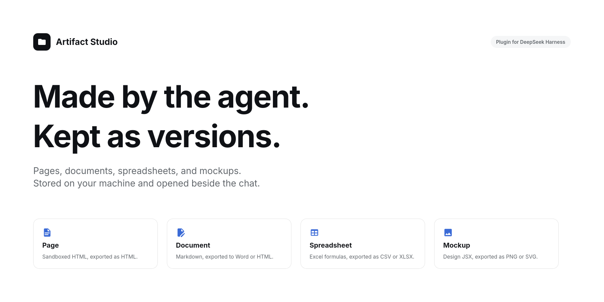
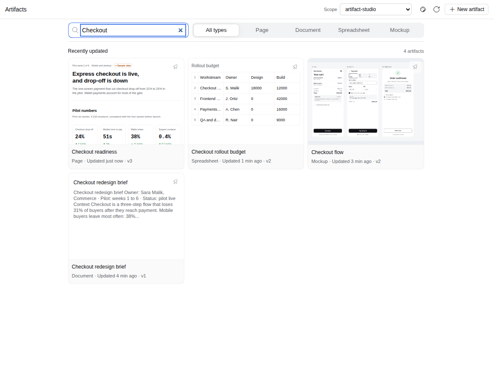
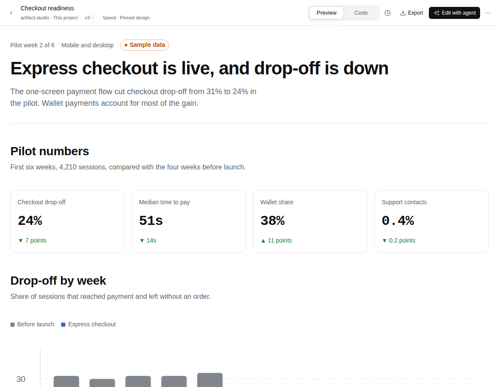
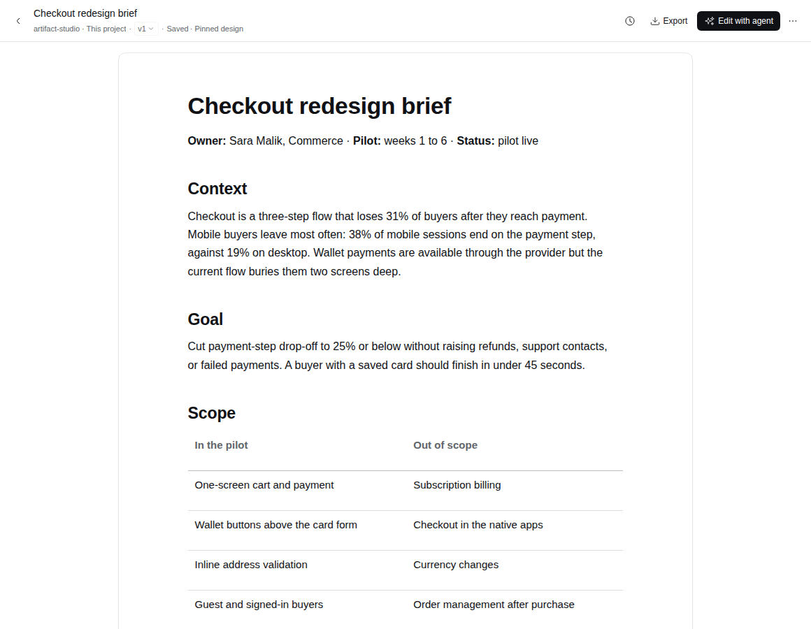
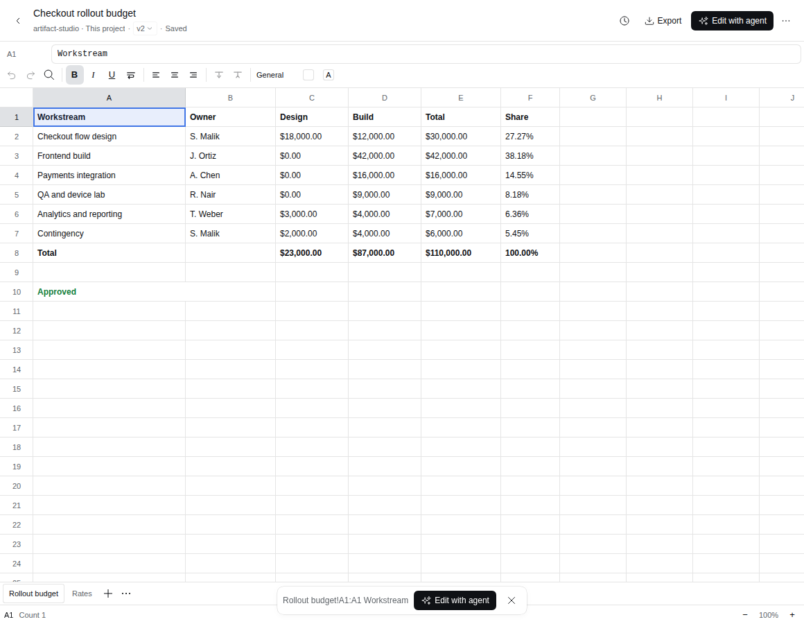
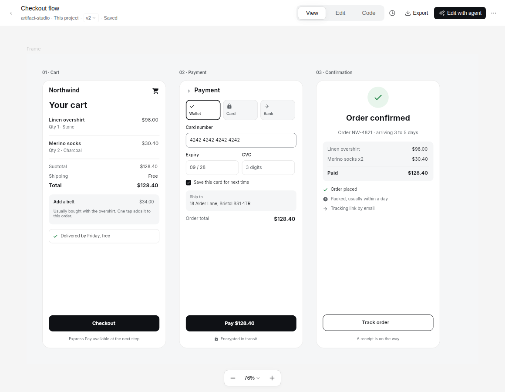

# Artifact Studio



[](https://www.npmjs.com/package/dsh-artifact-studio)
[](LICENSE)

Versioned pages, documents, spreadsheets, and mockups the agent writes and you edit beside the chat.

Artifact Studio is a plugin for the DeepSeek Harness Web app. The agent creates an artifact as a file on your machine, and you open it in a panel beside the conversation to read, edit, compare versions, and export. Artifacts need no account and no hosted service.

## Contents

- [Install](#install)
- [Quick start](#quick-start)
- [Artifact types](#artifact-types)
- [Agent tools](#agent-tools)
- [Versions and drafts](#versions-and-drafts)
- [Design systems and briefs](#design-systems-and-briefs)
- [Storage](#storage)
- [Editing in the panel](#editing-in-the-panel)
- [Privacy and security](#privacy-and-security)
- [Limits](#limits)
- [Troubleshooting](#troubleshooting)
- [Develop](#develop)
- [Credits](#credits)
- [License](#license)

## Install

Add the package to the Web profile. The profile flag is required.

```bash
dsh plugin --profile web add dsh-artifact-studio
```

Reload the Harness window after the command, and restart DeepSeek Harness if the Artifacts row does not appear. The package ships a bundle patch that adds three plugin entries: the panel and its local route, the fifteen agent tools, and the bundled skills.

A local checkout needs a link and a build:

```bash
npm install
npm run build
dsh plugin --profile web add link:/absolute/path/to/dsh-artifact-studio
```

Rebuild and restart the Web profile after a source change, then reload the window. See [Develop](#develop) for the checks.

## Quick start

1. Open a session in any workspace.
2. Ask for the artifact you want. For example: "Create an artifact page that compares our three pricing tiers and recommends one."
3. The reply includes a card for the new artifact. Select the card to open it in a tab.
4. Edit in the panel, or ask the agent for a change. Export from the header.

The Artifacts row in the left sidebar opens the full page: search, a scope selector for all projects, one project, or the library, type filters, covers, and pins. The New artifact button creates one from a starter template. The Artifacts guide in the right panel shows the same list for the current project, and each card opens its own tab. The Artifacts button in the composer lists recent artifacts and starter prompts.



The screenshots use a sample checkout project. Its numbers and names are illustrative.

## Artifact types

| Type | Stored as | Edited in | Exports |
| --- | --- | --- | --- |
| Page | `content/index.html` | Sandboxed HTML preview and code editor | HTML |
| Document | `content/document.md` | Rich text editor | Markdown, Word, HTML |
| Spreadsheet | `content/sheet.json` | Grid with a formula bar | CSV, XLSX |
| Mockup | `content/design.jsx` | Canvas with inspector | PNG, SVG, .fig, HTML viewer, HTML with text |

### Pages

A page is one HTML document. It renders in a sandbox with scripts allowed and every network request blocked, so inline every style, script, and image. Preview renders the page and Code edits it. Save or Ctrl/Cmd+S writes a version. A page that declares `<meta name="color-scheme" content="light dark">` follows the Harness dark theme; without the meta it keeps its light colors.

A page write returns warnings for a network URL, a browser storage API, a fixed width over 960 pixels, a missing viewport meta, a literal color or font, and a page that uses no design tokens. Warnings describe the source and do not block the save.



### Documents

A document is Markdown edited in a rich text editor. It autosaves about a second after a change, and formatting controls appear over a selection. The editor uses the same design tokens as the export, so the page matches the Word or HTML copy. Export as Markdown, Word, or HTML, or print it.



### Spreadsheets

A spreadsheet is one JSON workbook with cell values, styles, and Excel formulas. The panel edits it in a virtualized grid with a formula bar, a formatting toolbar, sheet tabs, merged cells, wrapped text, and undo. Changes autosave.

The panel, CSV, XLSX, and print copies share one evaluator, so a value is the same everywhere. The canonical workbook shape is documented in `src/sheet/model.ts`. A formula that fails is stored and shown as `#NAME?`, `#REF!`, `#DIV/0!`, `#VALUE!`, `#N/A`, or `#CYCLE!`. CSV exports one sheet, the first unless the agent names another. XLSX exports every sheet with styles, formulas, and cached results.



### Mockups

A mockup is stored as type `design`. It is OpenPencil Design JSX: frames, text, shapes, gradients, and bundled Material Design Icons. The host compiles it in a child process and saves a PNG preview.

View is the default mode and does not change the document. Edit adds the select, hand, shape, frame, and text tools plus undo, and opens an inspector with the layer tree and the selected layer's position, size, rotation, radius, opacity, visibility, and text properties. Selecting a layer turns it into an agent request. Edits stay a draft until Save. A version opened from History shows its saved PNG and is read only.

Exports are PNG, SVG, a `.fig` file for OpenPencil or Figma, a self-contained HTML viewer, and a smaller HTML page with the engine SVG and selectable HTML text.



## Agent tools

Tools read and write the same files the panel uses. They default to the session's workspace. Pass `workspaceId` to address another registered workspace; library artifacts take no workspace id.

| Tool | What it does |
| --- | --- |
| `artifact_create` | Create a page, document, spreadsheet, or mockup. |
| `artifact_read` | Read content or one saved version, a mockup outline, or spreadsheet values. |
| `artifact_update` | Save a new version with replace-once edits or complete content. |
| `artifact_patch` | Replace one mockup layer in place. |
| `artifact_sheet_update` | Apply cell, range, row, column, and sheet operations. |
| `artifact_list` | List artifacts in a project or the library. |
| `artifact_export` | Write a standalone file in one supported format, or one mockup layer as PNG or SVG. |
| `artifact_import` | Import a `.fig` file as a mockup. |
| `artifact_delete` | Move an artifact to the trash. |
| `artifact_preview` | Render a mockup, or one layer at its own size, and return the image to the model. |
| `artifact_brief` | Read the authoring brief and compatible recipes for one type. |
| `artifact_guide_update` | Save project conventions or a recipe. |
| `artifact_rebase` | Adopt newer design settings for a page or document. |
| `design_system_read` | Read the resolved tokens and where they come from. |
| `design_system_update` | Change tokens or a named system. |
| `design_system_list` | List named systems, the default, and the catalog revision. |

Fifteen tools are always registered. `artifact_preview` appears only when the profile mounts durable image storage and model routes.

### Bundled skills

The skill plugin registers three skills, and the Harness loads one when a task matches it.

| Skill | Use |
| --- | --- |
| `artifact-design` | Choose a type, load its brief, and follow its checks before saving. |
| `visual-codebase-walkthrough` | Trace a real code path, data flow, or change impact as a page with diagrams and source excerpts. |
| `visual-feature-flow` | Turn a requirement or UI change into a mockup of the real screens with numbered annotations. |

## Versions and drafts

- Every save creates a version. Restoring an old version appends a new one and leaves history intact.
- Writes use compare-and-set. `artifact_update` and `artifact_sheet_update` take a `baseVersion`, and a stale one is refused, so a save never overwrites a newer version.
- The store keeps the 50 newest versions and 20 MiB of version history per artifact, then prunes older versions.
- A page or document version pins its design tokens, system revision, recipe, and page kit when used. Editing text never restyles the artifact. `artifact_rebase` adopts current settings and appends a version. Mockups and spreadsheets have no pinned snapshot.
- Documents and spreadsheets autosave. Pages and mockups save from the header. A draft lives in window memory, shared by every tab open on that artifact, and does not survive a browser restart.
- Reload and Back ask to save, discard, or cancel when a draft is pending.
- When the agent saves a newer version, a clean tab reloads and names it. A tab with unsaved edits shows a conflict bar instead.
- History previews any saved version. Export and print use the selected version and never fall back to the latest.

## Design systems and briefs

Each project and the library keep design tokens. Named design systems live in one scope with immutable revisions and a default for new artifacts. A revision save is compare-and-set on the catalog, and a stale revision is refused. The tools are `design_system_read`, `design_system_update`, and `design_system_list`.

Tokens become CSS variables that pages and documents inherit, with light and dark values. A page follows dark mode only through its `color-scheme` meta. A mockup uses literal colors and fonts, so changing the tokens does not restyle it.

Recipes define the content structure for one intent. `artifact_brief` lists compatible recipes, then merges project conventions, user preferences, recipe rules, design context, and relevant earlier artifacts. A recipe id replaces the complete wider definition. Invalid guide or catalog files fail the read and stay on disk for manual repair.

Pages can opt into the shared kit with `<meta name="artifact-kit" content="1">` and the `ak-` classes it injects. A kit version fixes component definitions. Colors still come from the version's pinned tokens. The packaged [page reference](examples/page-design-system.html) shows the token patterns for a page without the kit.

## Storage

```text
$DSH_HOME/artifacts/
  workspaces/<workspaceId>/<artifact id>/
  v1/<artifact id>/                  library artifacts
  <scope>/.trash/                    deleted artifacts, kept 7 days
```

An artifact directory holds `artifact.json`, `content/`, and `versions/<n>/`. A mockup adds `preview/<sha256>.png` with a JSON summary. Tool exports land in `exports/`. Named design systems live in `<scope>/design-systems/index.json` with immutable `<system id>/<n>.json` revisions.

A workspace artifact is visible only in its registered workspace. A library artifact is visible in every project. The agent addresses another workspace by `workspaceId`, which must resolve through the workspace registry before any path is built.

The artifact menu copies or moves a workspace artifact to another registered workspace. A copy writes a new artifact under a new id with the same version history. A move follows the artifact to its destination and keeps the source in the workspace trash for 7 days.

A write takes an exclusive `.write-lock` file beside the artifact directory and is serialized per artifact in the process. A lock left by a crash is removed by hand after confirming no process is writing.

## Editing in the panel

The header carries the title, project, version picker, save status, history, and export. Pages and mockups add a mode switch. The more menu renames or deletes an artifact, and copies or moves a workspace one. Delete sends it to the trash.

Edit with agent saves pending edits, then places the selected text and a reference to the artifact, its workspace, and its saved version in the message box. You finish the sentence and send it. Selections work in documents, spreadsheet cells and ranges, the page preview, and page code. The full Artifacts page has no conversation, so it copies the same text instead.

Several tabs can show one artifact. They share the draft and serialize saves. The right panel guide opens the project list without leaving the conversation.

## Privacy and security

- Every artifact is a local file under `$DSH_HOME`. The plugin sends no telemetry and needs no account.
- A page preview runs with `sandbox="allow-scripts"` and no `allow-same-origin`, under a CSP that blocks network requests. Browser storage APIs throw.
- Mockup compilation runs in a separate Node process under the permission model: it reads only the plugin package and its installed modules, with no network, no file writes, and no child processes. A 20 second deadline stops a hung source.
- The canvas engine, icon set, and fonts are served from a fixed list of local assets. Artifact content is never served from that route, and rendering an artifact makes no network request.
- Gallery covers are scriptless, opaque-origin frames with scripts and inline handlers stripped.
- A selection quoted from a page preview is accepted only when the message comes from that frame.
- Library artifacts are shared across projects. Workspace artifacts stay in their workspace.

## Limits

| Item | Limit |
| --- | --- |
| Content per version | 2 MiB |
| Versions per artifact | 50 newest, 20 MiB of history |
| Title | 120 characters |
| List page | 50 artifacts per call |
| Sheets per workbook | 20 |
| Rows and columns per sheet | 5,000 rows, 100 columns |
| Cells and formulas per artifact | 20,000 cells, 5,000 formulas |
| Cells in a print copy | 20,000 per sheet |
| Mockup render | 20 seconds |
| `.fig` import | 128 MiB |
| Mockup preview | 1,600 pixels on the long side |

## Troubleshooting

| Symptom | What to do |
| --- | --- |
| `dsh plugin add` fails with a usage error | Add the profile: `dsh plugin --profile web add ...` |
| The agent has no artifact tools | Reload the window, then restart DeepSeek Harness if they are still missing. The profile must load `dsh-artifact-studio/tools`. |
| `artifact_preview` is missing | The profile needs image storage and model routes. Every other tool works without it. |
| A save is refused as stale | Another view or the agent saved first. Read the artifact again and reapply the change. |
| A mockup save fails | The message names a compile or validation problem in the Design JSX. Fix the source. If the renderer stopped, that is a plugin fault, so report the error. |
| A read fails as corrupt | A saved version or its generation snapshot cannot be read. Restore an earlier version or export before editing. |
| Writes fail after a crash | A `.write-lock` file was left beside the artifact. Confirm no Harness process is writing, then delete it by hand. |
| The full test suite is killed | It builds and runs every suite. Run one file, such as `node --test tests/sheet.test.mjs`, or run the full suite on a larger machine. |

## Develop

```bash
npm install
npm run typecheck   # host and client
npm run lint
npm run build
node --test tests/sheet.test.mjs
```

`npm run build` compiles the host into `dist/`, bundles `client.js` with the lazy `client.doc.js`, `client.sheet.js`, and `client.canvas.js`, and copies the canvas engine and its assets into `assets/`. Do not edit the built files.

`npm test` builds, then runs every suite in `tests/`. It is memory heavy and can be killed by the OS on a small machine.

Source layout:

- `src/host/` holds the local route, the tools, the artifact service and store, the exporters, and the design worker.
- `src/client/` holds the panel, the gallery, the editor models, and the three lazy chunks.
- `src/sheet/` holds the workbook model, operations, formula evaluation, and views shared by the host and the panel.
- `src/contract.ts` and `src/render.ts` are shared by both halves.
- `scripts/build.mjs` builds the bundles. `tests/` holds the suites and the optional browser checks.

A live check renders the running Web GUI in headless Chromium and prints console errors, page errors, and a screenshot:

```bash
npm run webcheck -- --path / --out .scratch/web-check/home.png
```

It needs a running Web profile at `$DSH_WEB_URL`, an installed Playwright and Chrome, and the profile's browser-session credential in `$DSH_HOME`. It installs nothing and prints no secret.

Runtime dependencies are MIT. Build-time dependencies bundled into a client chunk are MIT, Apache-2.0, or BSD-3-Clause, and each ships in [THIRD_PARTY_NOTICES.md](THIRD_PARTY_NOTICES.md). [AGENTS.md](AGENTS.md) records the package facts a new contributor needs, and [DESIGN.md](DESIGN.md) covers the panel chrome.

## Credits

- DeepSeek Harness and its UI primitives.
- OpenPencil and CanvasKit for the mockup engine and renderer.
- Tiptap for document editing.
- fast-formula-parser and fflate for spreadsheets.
- docx and marked for exports.
- Material Design Icons, Inter, Roboto, and Noto Naskh Arabic for the bundled assets.

## License

MIT. See [LICENSE](LICENSE).