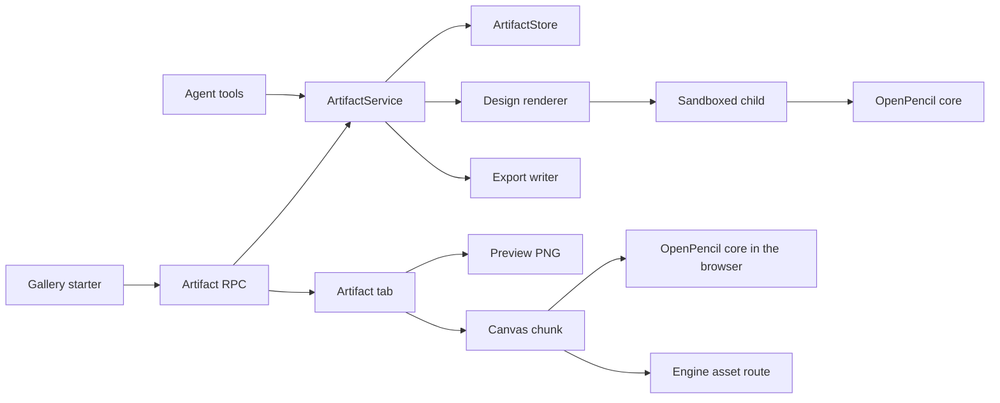
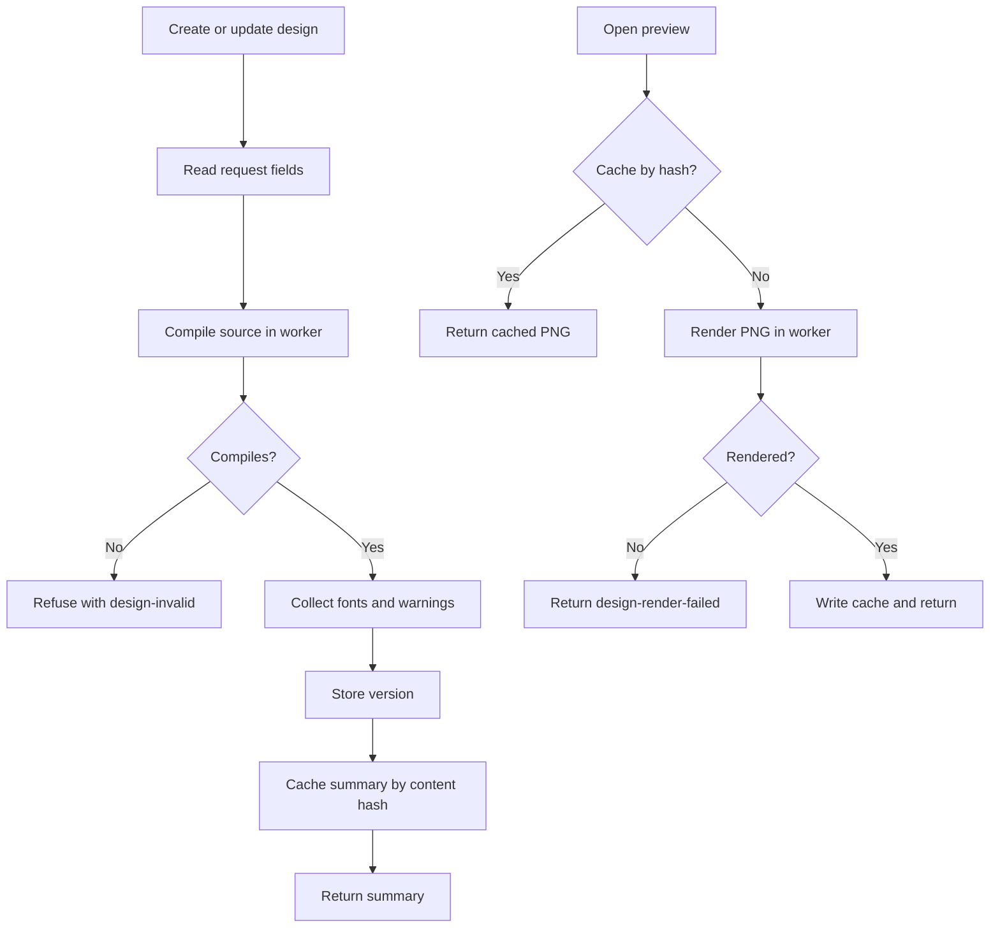
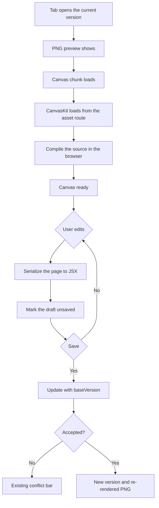
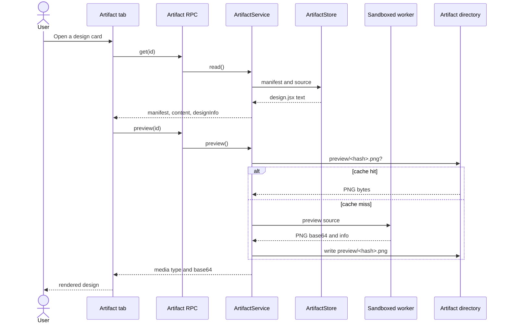
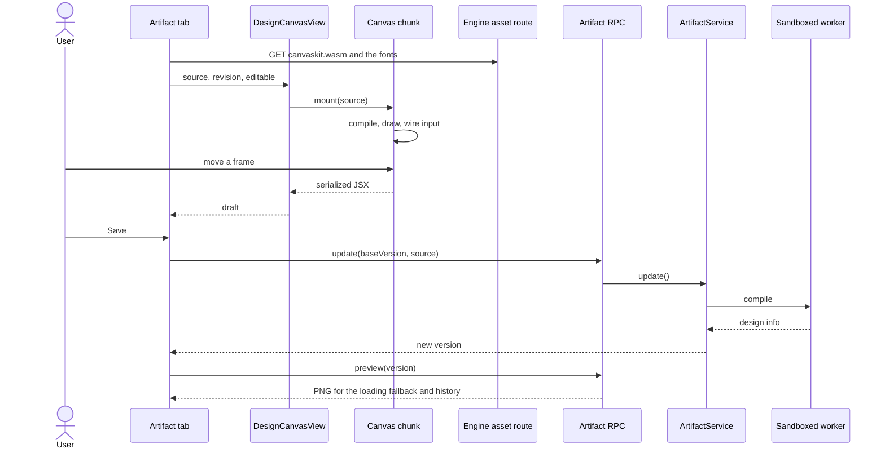
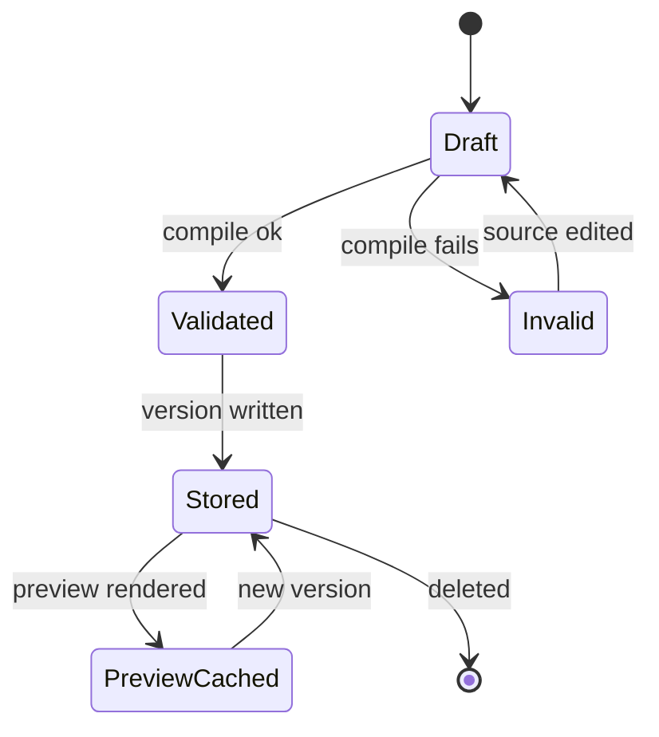
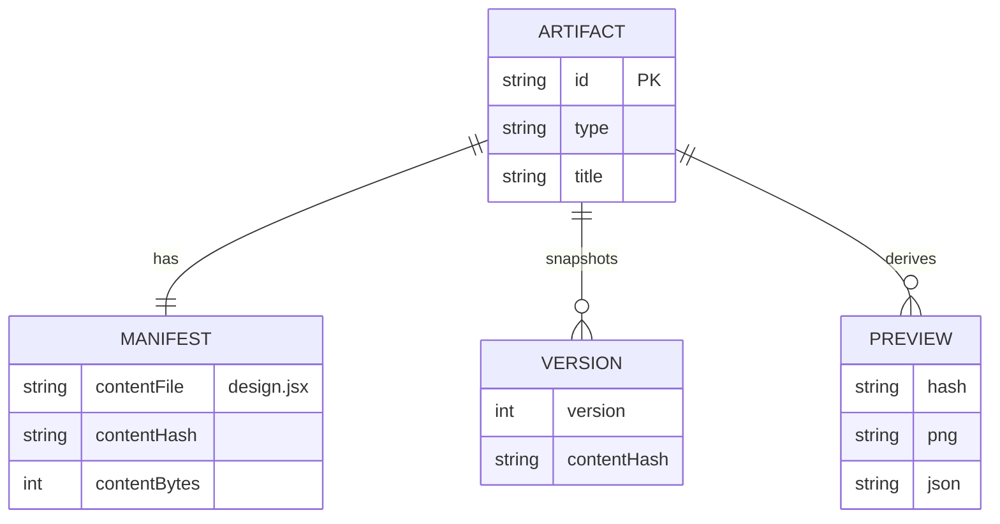

# OpenPencil design artifacts

> Artifact Studio gains a design type whose source is OpenPencil Design JSX, rendered on the host to a PNG preview and exported as PNG, SVG, or a native .fig document.

## 1. Feature Snapshot

| Field | Details |
| --- | --- |
| Document status | Active |
| Implementation status | Shipped (unverified); Phases 3 to 5 and 7 implemented |
| Owner | Parth Patel |
| Primary actors | Developer using the Harness; the agent in that session |
| Trigger | `artifact_create` with `type: "design"`, or the Design starter in the gallery |
| Outcome | A versioned Design JSX source, a rendered preview in the panel, and PNG, SVG, or .fig export |
| Entry points | Agent tools; Artifacts gallery; artifact tab preview and source editor; export |
| Data stores | The existing artifact roots; design source in `content/design.jsx`, derived preview under `preview/` |
| External systems | None. Rendering runs offline in a sandboxed child process |
| Feature flag | None. The artifact records its type in its manifest |
| Last verified | 2026-11-14 on the working tree, in DSH Desktop 2.0.22-next for the canvas live pass, and in headless Chrome for the Phase 7 handle check. No commit recorded yet |

### At a Glance

Artifact Studio stores pages as HTML and documents as Markdown. A design is a third kind: a component tree written in OpenPencil Design JSX. The host compiles that source and rasterizes it with the OpenPencil engine, and the panel shows the PNG beside the source. The stored artifact stays readable text, so versions, diffs, and the source editor keep working. The native `.fig` file is a derived export, not the source of truth.

The implementation is on the working tree: 19 design tests and the full 114-test suite pass, and the packaged plugin renders from a clean install. No commit is recorded, so statements about the code are `Inferred`; they become `Current` at the next verified commit.

Phase 3 adds an in-panel canvas so the design can be edited where it is previewed. It is implemented on the working tree: the engine loads from a local asset route, a click selects a node, a drag moves it, undo restores it, Ctrl+S asks the tab to save, and the page serializes back to JSX that recompiles to the same node count. The suite is 132 tests, including 17 for the canvas, and a browser run of the built chunk drew and edited the live Pricing design. The live pass passed on 2026-11-14 in DSH Desktop 2.0.22-next: a frame was moved and saved, version 4 was stored from the user source, and that source re-rendered at 860x616 with 21 nodes and no warnings. No commit is recorded, so Phase 3 claims stay **Inferred**.

Phases 4 and 5 are implemented on the working tree. Icons come from the bundled Material Design Icons set, and Roboto is a second bundled family. A headless Chrome run expanded the tree, selected a text layer, renamed it, changed a width, drew three icons and Roboto text, and fetched `icons.json` only for the design with icons. The desktop live pass for these two phases is pending.

Phase 7 is implemented on the working tree. A mockup opens in View with no toolbar and a floating zoom dock. Edit adds the tools, undo, and redo, and opens a React inspector in the same right drawer as History. Clicking a layer shows a bar that turns the selection into a bounded agent request. The Vue rail is gone. The suite is 159 tests. A headless Chrome run exercised the real engine bridge: the tree expanded, a text layer was selected, its quote and path were read, a width previewed and committed once, undo restored it, the tool and mode changed, the canvas fitted and zoomed, and the mount tore down. The React chrome was checked through its client tests, not in a running desktop GUI. No commit is recorded, so Phase 7 claims stay **Inferred**.

### Status Legend

- **Current**: implemented, and read in the code at `last_verified_commit`.
- **Planned**: approved, not implemented.
- **Inferred**: consistent with the evidence, not directly verified.
- **Unknown**: unresolved, tracked in §28.

## 2. Problem and Outcome

### Problem

Pages and documents cover prose and standalone HTML. When the user asks for a visual layout, a dashboard, or a UI exploration, the only option today is for the agent to hand-write HTML, which is markup rather than a design tree. The installed third-party OpenPencil plugin offers a design canvas, but it is a separate 30 MB host package plus a 104 MB native runtime per platform, and its draft, gate, and repair pipeline is the source of its bugs.

The upstream project now ships a MIT-licensed engine as pure JavaScript and WebAssembly. The engine renders a Design JSX string to a scene graph without a browser, which makes a small, offline design type possible inside Artifact Studio.

### Desired Outcome

The agent writes Design JSX once and saves it as a versioned artifact. The user sees a faithful PNG in the tab within about a second, can read and edit the JSX in the existing source editor, and can export a PNG, an SVG, or a `.fig` document that opens in the OpenPencil desktop or web app.

### Success Measures

| Measure | Target | How measured |
| --- | --- | --- |
| Preview latency, first open of a version | Under 3 s on this machine | Host timing in a test |
| Preview latency, cached open | Under 50 ms | Host timing in a test |
| Invalid source never stored | 0 versions written for a failed compile | Host test |
| Renderer isolation | No host crash or file write from a hostile source | Host test |

## 3. Scope

### Included

- A `design` artifact type stored as `content/design.jsx`.
- Host-side compile and render of Design JSX with `@open-pencil/core`.
- A sandboxed child process for compile, render, and export.
- A preview PNG endpoint and per-content-hash disk cache.
- Warnings for unbundled fonts; unknown icons are refused with a clear message.
- Export to `png`, `svg`, and `fig`.
- Source editor, versions, restore, history, and delete for designs.
- Agent guidance so the model knows the Design JSX dialect and its limits.
- A gallery starter that creates a small working design.
- An in-panel canvas for the current version: pan, zoom, zoom to fit, select, move, resize, inline text edit, delete, undo, redo, and drawing a Frame or Text.
- Canvas edits as an unsaved draft of the source; Save writes a version through the existing update contract.
- A fixed asset route for the engine's CanvasKit WebAssembly, the bundled fonts, and the bundled icon set.
- A View-first canvas: the saved mockup opens in View with no toolbar, a floating zoom dock, and click selection. Edit adds select, hand, frame, and text tools, undo, redo, and the inspector.
- A React inspector in the tab's right drawer, shared with History, with a layer tree and a properties panel for the selection. It reads a typed snapshot from the canvas handle and writes only through the handle.
- A layer bar above the dock that turns a selected layer into an Edit with agent request carrying its name, path, and Design JSX.
- The bundled Material Design Icons set, resolved offline from a local asset, so `<Icon name="mdi:...">` compiles, previews, and draws.
- Roboto as a second bundled family, loaded from the asset route and available to previews and the canvas.
- Gallery covers that show the saved PNG for visible mockups, at most two requests at a time, cached per id and version for the window.

### Excluded

- Fills, strokes, effects, component authoring, variables, and page navigation in the properties panel. The panel covers geometry, appearance, and basic text properties.
- Icon sets other than Material Design Icons, and network icon search. The picker is not in the canvas; the agent authors `mdi:` names.
- Font families other than Inter, Noto Naskh Arabic, and Roboto. Families outside that set still warn and substitute.
- Editing a saved version in place. Viewing an old version keeps the read-only PNG preview.
- Round-tripping a design edited in the OpenPencil desktop app. The app writes `.fig`, and no upload path exists in this phase.
- Autosave from the canvas. Save stays explicit, as it is for the source editor.
- Figma `.fig` import. The engine supports it; this feature does not expose it. See Phase 6.
- Design tokens from Artifact Studio applied to a design. Designs carry their own colors.
- Printing a design. The existing print path covers pages and documents.

### Assumptions

| ID | Assumption | Confidence | Validation needed |
| --- | --- | --- | --- |
| ASM-001 | `renderJSX(graph, source)` renders offline from a Node child process | High | Spike on 2026-11-14 rendered a 360x156 PNG in 136 ms after init |
| ASM-002 | A PNG preview is not enough once the user wants to edit; the canvas becomes the main review and edit surface | High | The user asked for the canvas on 2026-11-14 |
| ASM-003 | Node's permission model is available in the Harness runtime | High | Node 24.18.1 ran the render under `--permission` |
| ASM-004 | Rejecting `<Icon>` is acceptable until a local icon source exists | Medium | User feedback; revisit in Phase 2 |
| ASM-005 | The OpenPencil Vue SDK and CanvasKit run inside the Harness Web client | High | Spike on 2026-11-14 mounted the SDK in a page, drew the live design, selected and moved a frame, undid it, and serialized it back |
| ASM-006 | esbuild can bundle the Vue SDK without the Vite plugin the SDK documents | High | Spike built a 3.8 MB minified chunk with esbuild 0.25 and ran it in headless Chrome with SwiftShader WebGL |

## 4. Terminology

| Term | Meaning |
| --- | --- |
| Design JSX | OpenPencil's component dialect (`Frame`, `Text`, `Rectangle`, `Ellipse`, `Vector`, and so on), compiled by `@open-pencil/design-jsx` through sucrase. It is not React DOM. |
| Scene graph | The editor's document model, `SceneGraph` from `@open-pencil/scene-graph`. |
| Native document | A `.fig` file, the writable native format of the current OpenPencil engine. `.pen` is read-only. |
| Preview | A derived PNG rendered from the stored source. It is never the source of truth. |
| Bundled font | A font file shipped in `@open-pencil/core/assets`: Inter in five weights and Noto Naskh Arabic. |
| View | The default canvas mode. A drag pans from any point, the wheel pans and Ctrl or Cmd wheel zooms, and a click selects; no tool can change the document. |
| Edit | The canvas mode that adds the drawing tools, undo and redo, and the inspector. |
| Inspector | The React panel in the tab's right drawer with the Layers tree and the selection's Properties. |
| Mockup | The user-facing name for a design artifact. The stored type stays `design`. |

## 5. Actors and Permissions

| Actor | Allowed actions | Restrictions | Enforcement point |
| --- | --- | --- | --- |
| Local owner | Read, create, edit, restore, export, delete designs in both scopes | Same route admission as every artifact | `src/host/lib/http.ts` |
| Agent session | Create, read, update, list, delete, export designs through tools | A workspace artifact needs the session's workspace | `src/host/lib/tools.ts` |
| Renderer child | Compile and rasterize one request | No network, no filesystem writes, no child processes; killed after a timeout | `--permission` flags in `design-render.ts` |
| Canvas chunk | Compile, draw, and serialize one open design | Reaches only the artifact route and the engine asset route; no filesystem, no host capability | `src/client/canvas/` |

## 6. User Journey

1. The user asks for a visual layout.
2. The agent calls `artifact_create` with `type: "design"`, a title, and a Design JSX string.
3. The host compiles the source. A compile error returns `artifact/design-invalid` with the compiler message, and nothing is written.
4. The host stores version 1 and returns a summary with warnings, if any.
5. The user opens the artifact card. The tab requests `preview`, receives a PNG, shows it while the canvas opens, then shows the saved mockup in View with the zoom dock.
6. The user switches to Edit to draw or adjust layers, or selects a layer in View and asks the agent to change it. The request quotes the layer's name, path, and JSX.
7. The user saves. The host validates the source, writes version 2, and both views follow the new version. The user can export PNG, SVG, or `.fig` and open the file in OpenPencil for the full editor.

### Alternate Journeys

| Journey | Trigger | Expected outcome |
| --- | --- | --- |
| Invalid edit | The source does not compile | Save is refused, the previous version stays, the editor shows the error |
| Render failure | The worker crashes or times out | Preview area shows the error with Retry; the source stays readable |
| Restore | The user restores an older version | A new version repeats the old source; the preview renders that source |
| Canvas edit, then save | The user moves or resizes a node in the canvas | The draft is marked unsaved; Save writes a new version from the engine's JSX serialization |
| Canvas unavailable | The chunk, CanvasKit, or WebGL fails | The PNG preview stays visible with an error bar and Retry; the source editor still works |
| Select and ask | The user clicks a layer and presses Edit with agent | The tab saves first; the composer receives the layer name, path, and JSX, shortened at 4,000 characters |
| Inspect and edit a layer | The user opens Edit and uses the inspector | Layers select, expand, hide, lock, and rename; Properties previews a number and commits once; Save stays explicit |
| View an old version | The user opens version 1 of 3 | The PNG for that version is shown read-only; no canvas mounts |
| Delete | The user deletes the artifact | It moves to trash with the rest of its directory |

## 7. System Context



The store, scopes, route, and version rules do not change. The new parts are the design type, the renderer client, the worker, the preview endpoint, and the export branches. Phase 3 adds a browser engine beside the host renderer: the canvas chunk loads lazily, the asset route serves CanvasKit and the fonts, and every save still goes through the one update endpoint.

## 8. Control Flow



| Step | Status | Controlling component | Decision or action | Failure behavior |
| --- | --- | --- | --- | --- |
| Validate source | Inferred | `ArtifactService` | Compile before any write | `artifact/design-invalid` |
| Store version | Inferred | `ArtifactStore` | Existing commit path | `artifact/storage-failure` |
| Render preview | Inferred | `DesignRenderer` | Spawn, timeout, parse | `artifact/design-render-failed` or `artifact/design-timeout` |
| Cache preview | Inferred | `ArtifactService` | Key by sha256 of source | A cache write failure is logged, not fatal |
| Export | Inferred | `writeExport` | Render from the saved version | `artifact/design-render-failed` |

### Canvas edit and save (planned)



| Step | Status | Controlling component | Decision or action | Failure behavior |
| --- | --- | --- | --- | --- |
| Load the chunk | Planned | `DesignCanvasView` | `require.async('./client.canvas.js')` once per window | PNG with an error and Retry |
| Load CanvasKit | Planned | Canvas chunk | Asset route URL plus the package version | PNG with an error and Retry |
| Compile the source | Planned | Canvas chunk | `renderJSX` in the browser | PNG with the compiler message |
| Serialize an edit | Planned | Canvas chunk | `selectionToJSX` for the page's top-level nodes | Keep the previous draft and show the failure |
| Save | Planned | Existing editor model | `update` with `baseVersion` | Existing stale-version conflict bar |

## 9. Data Flow



### Canvas edit and save (planned)



### Data Transformations

| Stage | Status | Input | Transformation | Output |
| --- | --- | --- | --- | --- |
| Create | Inferred | Design JSX string | Compile, layout, count nodes | Scene graph summary |
| Preview | Inferred | Design JSX string | Compile, rasterize, cap scale | PNG bytes |
| Export png | Inferred | Saved source | Same as preview at scale 1 | PNG file |
| Export svg | Inferred | Saved source | Compile, serialize vectors | SVG text |
| Export layer png/svg | Inferred | Live canvas graph and one selected node | Render that node in the browser | Downloaded PNG or SVG |
| Export fig | Inferred | Saved source | Compile, write Kiwi document | `.fig` bytes |
| Canvas render | Planned | Design JSX | Compile in the browser, draw with CanvasKit | Interactive scene |
| Canvas save | Planned | Edited scene graph | `selectionToJSX` on the page's top-level nodes | Design JSX source |

### Sensitive Data

| Data | Classification | Storage | Logging rule | Retention |
| --- | --- | --- | --- | --- |
| Design source | Internal | `content/design.jsx` plus version snapshots | Never logged in full | Same as the artifact |
| Preview PNG | Internal | `preview/<hash>.png` | Not logged | Pruned with the artifact; regenerated on demand |

## 10. State Model

The artifact lifecycle is unchanged. A design adds one derived-file state.



| State | Meaning | Allowed transitions | Side effects |
| --- | --- | --- | --- |
| Draft | Source received from a tool or the editor | Validated, Invalid | None |
| Invalid | Compile failed | Draft (after edit) | No version written |
| Stored | A version exists | PreviewCached, Stored, deleted | Manifest and snapshot on disk |
| PreviewCached | A PNG exists for the content hash | Stored | Derived file only |

The canvas adds no stored state. The scene graph lives in the browser while the tab is open, and only a Save writes. A compile that fails inside the canvas shows the host's compiler message when Save is refused; the stored source and version are untouched.

## 11. Implementation Map

### Existing Artifacts

| Layer | Responsibility | Repository path | Main symbol | Verified |
| --- | --- | --- | --- | --- |
| Contract | Types, content files, formats, payload | `src/contract.ts` | `ARTIFACT_TYPES`, `CONTENT_FILE`, `FORMATS_BY_TYPE` | Yes |
| Store | Versioned text storage | `src/host/lib/store.ts` | `ArtifactStore` | Yes |
| Service | Scope, design system, export facade | `src/host/lib/service.ts` | `ArtifactService` | Yes |
| RPC | Endpoint dispatch | `src/host/lib/rpc.ts` | `ENDPOINTS` | Yes |
| Export | File writers | `src/host/lib/export.ts` | `writeExport` | Yes |
| Tools | Agent surface | `src/host/lib/tools.ts` | `createTools` | Yes |
| Client | Tab, gallery, card, API | `src/client/` | `ArtifactTab`, `Gallery` | Yes |

### Implemented Artifacts (uncommitted)

Status: **Inferred**. The files exist and the tests below pass; no commit is recorded yet.

| Layer | Responsibility | Planned path | Main symbol | Change type |
| --- | --- | --- | --- | --- |
| Contract | Add the design type and formats | `src/contract.ts` | `CONTENT_FILE.design`, `FORMATS_BY_TYPE.design`, `DesignInfo` | Modify |
| Host | Spawn, sandbox, timeout, protocol | `src/host/lib/design-render.ts` | `DesignRenderer` | Create |
| Host | One-shot worker entry | `src/host/worker/design-worker.ts` | `main` | Create |
| Host | Validate, cache, preview | `src/host/lib/service.ts` | `designInfo`, `preview` | Modify |
| Host | Endpoint | `src/host/lib/rpc.ts` | `preview` | Modify |
| Host | Export branches | `src/host/lib/export.ts` | `writeExport` | Modify |
| Host | Tool enums and guidance | `src/host/lib/tools.ts` | `PAGE_GUIDE`, schemas | Modify |
| Client | Preview, source toggle, errors | `src/client/artifact-tab.tsx` | `DesignPreview` | Modify |
| Client | Preview request | `src/client/api.ts` | `preview` | Modify |
| Client | Type icon and label | `src/client/card.tsx`, `src/client/icons.tsx` | `IconDesign` | Modify |
| Client | Starter | `src/client/gallery.tsx`, `src/client/templates.ts` | `design` starter | Modify |
| Client | Strings | `src/client/locale.ts`, `locale/en.json`, `locale/zh.json` | `type.design`, `preview.*` | Modify |

### Implemented for Phase 3 (uncommitted)

Status: **Inferred**. The files exist and the tests pass; no commit is recorded and the live pass is pending.

| Layer | Responsibility | Repository path | Main symbol | Change type |
| --- | --- | --- | --- | --- |
| Build | Engine ES module, loader chunk, asset copy, Vue defines, node-builtin externals | `scripts/build.mjs` | `bundle`, `copyAssets` | Modify |
| Client | Engine module: mount, compile, edit, serialize, keyboard | `src/client/canvas/entry.ts` | `mountDesignCanvas` | Create |
| Client | CommonJS chunk the tab loads; imports the engine module | `src/client/canvas/loader.ts` | `mountDesignCanvas` | Create |
| Client | Vue surface that wires `useCanvas` and `useCanvasInput` | `src/client/canvas/surface.ts` | `CanvasSurface` | Create |
| Client | Empty module the build aliases over the unused WebGPU shader renderer | `src/client/canvas/shaders-stub.ts` | `createRendererFromJSON` | Create |
| Client | React view: chunk lifecycle, toolbar, fallback, status | `src/client/design-canvas-view.tsx` | `DesignCanvasView` | Create |
| Client | Design tab branch and save wiring | `src/client/artifact-tab.tsx` | preview branch | Modify |
| Client | Strings and canvas chrome | `src/client/locale.ts`, `src/client/styles.ts` | `canvas.*` | Modify |
| Host | Fixed allowlist route for the engine files | `src/host/lib/assets.ts` | `registerCanvasAssetsRoute` | Create |
| Host | Register the asset route beside the RPC route | `src/host/index.ts` | `apply` | Modify |
| Package | Build dependencies, shipped assets, version | `package.json`, `.gitignore`, `THIRD_PARTY_NOTICES.md` | `devDependencies`, `files` | Modify / Create |
| Tests | Asset route, packaging, and notices | `tests/canvas-assets.test.mjs` | AC-025 to AC-027 | Create |
| Tests | Engine round-trip, canvas save, build output | `tests/canvas.test.mjs` | AC-019, AC-024, AC-026 | Create |
| Tests | Tab mount, fallback, draft, destroy | `tests/client.test.mjs` | AC-017, AC-018, AC-020 to AC-023 | Modify |

### Implemented for Phase 4 and Phase 5 (uncommitted)

Status: **Inferred**. The files exist and the tests pass; the desktop live pass is pending.

| Layer | Responsibility | Repository path | Main symbol | Change type |
| --- | --- | --- | --- | --- |
| Client | Rail layout with the layer tree and properties panel (deleted in Phase 7; replaced by the React inspector) | `src/client/canvas/panels.ts` | `DesignPanels` | Create, later Delete |
| Client | Rail toggle and default width in the React view | `src/client/design-canvas-view.tsx` | `DesignCanvasView` | Modify |
| Client | Panel strings and chrome | `src/client/locale.ts`, `src/client/styles.ts` | `panel.*` | Modify |
| Shared | Local Iconify client over the bundled set | `src/icon-set.ts` | `bundledIconProvider` | Create |
| Host | Worker icon provider and bundled font loading | `src/host/worker/design-worker.ts` | `main` | Modify |
| Client | Canvas icon provider and bundled font loading | `src/client/canvas/entry.ts` | `mountDesignCanvas` | Modify |
| Host | Icon and font files in the fixed asset list | `src/host/lib/assets.ts` | `ASSET_FILES` | Modify |
| Build | Copy the icon set and the Roboto files | `scripts/build.mjs` | `copyAssets` | Modify |
| Package | Icon and font build dependencies | `package.json`, `THIRD_PARTY_NOTICES.md` | `devDependencies` | Modify |
| Tests | Panels in the browser run; icons and fonts in the worker | `tests/canvas.test.mjs`, `tests/design.test.mjs`, `tests/canvas-assets.test.mjs` | AC-030 to AC-043 | Modify |

### Implemented for Phase 7 (uncommitted)

Status: **Inferred**. The files exist, the typecheck is clean, and 159 tests pass; no commit is recorded and the desktop live pass is pending. A headless Chrome run exercised the real engine bridge: it expanded the layer tree, selected a text layer, read its quote and path, previewed and committed a width, undid it, switched tool and mode, fitted, zoomed, and destroyed the canvas.

| Layer | Responsibility | Repository path | Main symbol | Change type |
| --- | --- | --- | --- | --- |
| Client | Snapshot and mutation bridge over the Vue editor | `src/client/canvas/bridge.ts` | `createCanvasBridge` | Create |
| Client | Handle API, mode, fit tracking, selection quote | `src/client/canvas/entry.ts` | `DesignCanvasHandle` | Modify |
| Client | View input: drag panning and release-click selection without editing; Ctrl wheel zoom caught before the engine | `src/client/canvas/surface.ts` | `CanvasSurface` | Modify |
| Client | Zoom range and the wheel and pinch scale steps | `src/client/canvas/zoom.ts` | `wheelZoom`, `clampZoom` | Create |
| Client | Vue rail with the layer tree and properties | `src/client/canvas/panels.ts` | `DesignPanels` | Delete |
| Client | Floating dock, opening and failure surfaces | `src/client/design-canvas-view.tsx` | `DesignCanvasView` | Modify |
| Client | React Layers and Properties inspector | `src/client/design-inspector.tsx` | `DesignInspector` | Create |
| Client | View, Edit, and Code modes, layer bar, shared drawer | `src/client/artifact-tab.tsx` | `ArtifactBody` | Modify |
| Client | Layer quote with a 4,000 character bound | `src/client/review.ts` | `buildDesignQuote` | Modify |
| Client | Inline layer, tool, eye, lock, undo, and redo icons | `src/client/icons.tsx` | `IconLayerFrame`, `IconCursor`, `IconUndo` | Modify |
| Client | Primitive declarations for the dock and inspector | `src/client/primitives.d.ts` | `ZoomControls`, `Switch`, `Input`, `SegmentedTabs` | Modify |
| Client | Mockup covers from the preview endpoint | `src/client/gallery.tsx` | `queueDesignCover` | Modify |
| Client | Mockup copy, inspector strings, and dock chrome | `src/client/locale.ts`, `src/client/styles.ts` | `canvas.*`, `layer.*`, `panel.*` | Modify |
| Host | Skill tells the agent to say mockup | `src/host/lib/skill.ts` | `ARTIFACT_DESIGN_SKILL` | Modify |
| Tests | Primitive stand-ins for the dock and inspector | `tests/primitives-stub.cjs` | `ZoomControls`, `Switch`, `Input`, `SegmentedTabs` | Modify |
| Tests | Modes, dock, layer bar, quote, drawer, inspector, covers, naming | `tests/client.test.mjs` | AC-043 to AC-065 | Modify |

### Generated or Restricted Areas

| Path or area | Classification | Rule |
| --- | --- | --- |
| `dist/` | Generated | Written by `npm run build`; never edited |
| `client.js`, `client.doc.js`, `client.canvas.js` | Generated | Written by `scripts/build.mjs` |
| `assets/canvaskit.wasm`, `assets/fonts/*.ttf`, `assets/canvas.engine.js` | Generated | Written by `scripts/build.mjs` from the installed build dependencies |
| `assets/icons.json`, `assets/fonts/Roboto-*.woff2` | Generated | Copied from `@iconify-json/mdi` and `roboto-fontface` by `scripts/build.mjs` |
| `preview/` under an artifact | Derived | Safe to delete; regenerated on demand |

## 12. Contracts

### Tool Surface

Status: **Inferred** (implemented, uncommitted)

`artifact_create` and `artifact_update` accept `type: "design"`. `artifact_read` returns the source plus `designInfo`. `artifact_list` accepts `type: "design"`. `artifact_export` accepts `png`, `svg`, and `fig`. `artifact_export` and `artifact_preview` accept a dotted layer `path` from the outline to render one frame, component, or layer; a layer export is `png` or `svg`, because the other formats carry the whole design.

```ts
interface DesignInfo {
  pages: number;
  nodes: number;
  types: Record<string, number>;
  fonts: string[];
  warnings: string[];
  outline?: DesignOutlineRow[];
}
```

### RPC Endpoint

`POST /artifacts-rpc/preview`

Status: **Inferred** (implemented, uncommitted)

#### Request

```json
{ "workspaceId": "ws_123", "id": "art_ws_abc123" }
```

#### Success Response

```json
{
  "type": "server-response",
  "rpcId": "r1",
  "result": {
    "ok": true,
    "value": {
      "mediaType": "image/png",
      "data": "<base64>",
      "width": 1200,
      "height": 800,
      "scale": 1,
      "info": { "pages": 1, "nodes": 40, "types": { "FRAME": 12 }, "fonts": ["Inter"], "warnings": [] }
    }
  }
}
```

#### Errors

| Code | Meaning | Retriable |
| --- | --- | --- |
| `artifact/not-found` | Unknown or malformed id | No |
| `artifact/unsupported-type` | The artifact is not a design | No |
| `artifact/design-render-failed` | The worker failed or returned no image | Yes, after fixing the source |
| `artifact/design-timeout` | The worker exceeded its deadline | Yes |

### Worker Protocol

Status: **Inferred** (implemented, uncommitted)

One JSON request on stdin, one JSON response on stdout.

```ts
type WorkerRequest =
  | { action: 'inspect'; source: string }
  | { action: 'preview'; source: string; maxSide: number }
  | { action: 'export'; source: string; format: 'png' | 'svg' | 'fig' };
```

### Engine Asset Route

Status: **Inferred** (implemented, uncommitted)

`GET /artifacts-canvas/canvas.engine.js`, `GET /artifacts-canvas/canvaskit.wasm`, and `GET /artifacts-canvas/fonts/<name>.ttf`

The route serves only the names in a fixed list, resolved from the installed package's `assets/` directory. The request path is never joined to a filesystem path; a name that is not in the list is a 404.

| Request | Response |
| --- | --- |
| `GET /artifacts-canvas/canvas.engine.js` | 200, `text/javascript`, 3.8 MB |
| `GET /artifacts-canvas/canvaskit.wasm` | 200, `application/wasm`, 7.1 MB |
| `GET /artifacts-canvas/fonts/Inter-Regular.ttf` | 200, `font/ttf` |
| A name outside the list | 404 |
| A method other than GET or HEAD | 405 |
| `?v=<package version>` | Ignored by the route, used by the client for cache busting |

Headers: `cache-control: public, max-age=31536000, immutable` because the URL carries the package version. The route does not call artifact admission: the files are public engine assets with no user data. The Web shell's own request gate still applies. A 404 for an unlisted name is also what a missing generated file returns, so a build that skipped `assets/` fails the canvas closed.

### Canvas Chunks

Status: **Inferred** (implemented, uncommitted)

`client.canvas.js` is loaded with the existing module loader. It is a 779-byte CommonJS chunk whose only job is to import the engine module and forward the mount call. The engine itself is `assets/canvas.engine.js`, an ES module, because the engine's layout library uses top-level await and the CommonJS module loader cannot evaluate it.

```ts
type CanvasTool = 'select' | 'hand' | 'frame' | 'text';
type CanvasMode = 'view' | 'edit';
type SelectionMode = 'replace' | 'add' | 'range';
type PropertyKey = 'x' | 'y' | 'width' | 'height' | 'rotation' | 'radius' | 'opacity' | 'fontSize';

interface SelectedLayer { id: string; name: string; type: string; parentName: string }
interface LayerRowView { id: string; name: string; type: string; level: number; hasChildren: boolean; expanded: boolean; visible: boolean; locked: boolean; selected: boolean }
interface CanvasProperties {
  ids: string[];
  name: string | null;
  type: string | null;
  x: number | null; y: number | null; width: number | null; height: number | null;
  rotation: number | null; radius: number | null; opacity: number | null;
  visible: boolean | null;
  text: { family: string; weight: number; fontSize: number } | null;
}
interface CanvasSnapshot {
  selection: SelectedLayer[];
  rows: LayerRowView[];
  properties: CanvasProperties;
  isText: boolean;
  canUndo: boolean;
  canRedo: boolean;
  zoom: number;
  tool: CanvasTool;
  fit: boolean;
}
interface LayerQuote { name: string; path: string; type: string; parentName: string; jsx: string }

interface DesignCanvasOptions {
  element: HTMLElement;
  source: string;
  mode: CanvasMode;
  onChange(source: string): void;
  onSave(): void;
  onFailure?(message: string): void;
  t(key: string): string;
}

interface DesignCanvasHandle {
  setSource(source: string): void;
  setMode(mode: CanvasMode): void;
  setTool(tool: CanvasTool): void;
  undo(): void;
  redo(): void;
  zoomToFit(): void;
  setZoom(zoom: number): void;
  getSnapshot(): CanvasSnapshot;
  subscribe(listener: (snapshot: CanvasSnapshot) => void): () => void;
  select(id: string, mode: SelectionMode): void;
  clearSelection(): void;
  toggleExpand(id: string): void;
  toggleVisibility(id: string): void;
  toggleLock(id: string): void;
  rename(id: string, name: string): void;
  setVisible(visible: boolean): void;
  preview(prop: PropertyKey, value: number): void;
  commit(prop: PropertyKey, value: number, previous: number): void;
  setFamily(family: string): void;
  setWeight(weight: number): void;
  quoteSelection(): LayerQuote | null;
  destroy(): void;
}

declare function mountDesignCanvas(options: DesignCanvasOptions): Promise<DesignCanvasHandle>;
```

The engine waits for CanvasKit before it mounts, compiles the source, creates the editor, and reports ready by resolving the promise. A mount failure rejects; the tab keeps the PNG and shows the retry bar. The engine serializes an edited page with `selectionToJSX(page.childIds, graph)` from `@open-pencil/design-jsx` on every settled history entry. It never writes; `onChange` hands the text to the tab's draft and `onSave` asks the tab to save. External revisions arrive through `setSource`, which recompiles and replaces the graph.

A hidden Vue component inside `LayerTreeRoot` reads the SDK's composables and fills `src/client/canvas/bridge.ts`. The bridge builds a plain snapshot on every settled change and hands out the mutation methods above. Snapshot fields are either a value or null when the selected layers disagree. `quoteSelection` walks the graph for the node's path and serializes only that node. In View the engine's own input is disabled and the surface keeps click selection, wheel pan and zoom, and pointer panning: a left press starts a pan anywhere, including on a frame, and a release without movement selects the layer under the press, so no gesture can change the document and a drag never selects the frame it started on.


## 13. Data Model and Storage



| Store | Status | Purpose | Important keys or fields |
| --- | --- | --- | --- |
| `content/design.jsx` | Inferred | Current source | Text, 2 MiB cap |
| `versions/<n>/content/design.jsx` | Inferred | Immutable snapshots | Existing store path |
| `preview/<hash>.png` | Inferred | Derived preview | Hash is sha256 of the source |
| `preview/<hash>.json` | Inferred | Summary, warnings, size | Written with the preview |

### Caching

A preview is keyed by the sha256 of the source. The current version's cache is reused across processes. Old cache files are pruned to the current hash when a new version is written. A cache miss renders; a render failure writes no cache. Cache files are derived and must never be read as content.

## 14. Business Rules

| Rule ID | Status | Rule | Enforcement point | Test reference |
| --- | --- | --- | --- | --- |
| BR-001 | Inferred | A design's stored content is Design JSX. A `.fig` is derived, never stored | `ArtifactService` | Host test |
| BR-002 | Inferred | A source that does not compile is refused before any directory or version is written | `ArtifactService` | AC-002 |
| BR-003 | Inferred | A design update with `edits` is applied, validated, then written as content | `ArtifactService` | AC-008 |
| BR-004 | Inferred | `<Icon>` is rejected, never silently dropped | Worker | AC-011 |
| BR-005 | Inferred | Exports render from the named saved version, never from the preview cache | `writeExport` | AC-009 |
| BR-006 | Inferred | The worker runs out of process, with no network and no filesystem writes | `design-render.ts` | AC-016 |
| BR-007 | Inferred | A preview failure never makes the source unreadable | Tab and service | AC-007 |
| BR-008 | Inferred | Unbundled fonts produce warnings, not refusals | Worker and service | AC-012 |
| BR-009 | Inferred | The artifact type never changes after creation | `ArtifactStore` | Existing rule |
| BR-010 | Inferred | Design JSX auto-layout uses `flex` (`row` or `col`). `dir` is accepted and ignored, so every child sits at the same origin | Bundled skill, gallery starter | FEAT-007 AC-012b |
| BR-011 | Inferred | A canvas save replaces `content/design.jsx` with the engine's serialization of the page. Comments and hand-written formatting are not preserved | Canvas chunk and `ArtifactService` | AC-019 |
| BR-012 | Inferred | Canvas edits are a draft until Save. No interaction writes to disk | `DesignCanvasView` and the editor model | AC-018 |
| BR-013 | Inferred | The asset route serves only names from a fixed list. No request path reaches the filesystem | `src/host/lib/assets.ts` | AC-025 |
| BR-014 | Inferred | Runtime dependencies stay MIT. A bundled build dependency may be BSD-3-Clause only with a notice in `THIRD_PARTY_NOTICES.md` | `tests/package.test.mjs` | AC-027 |
| BR-015 | Inferred | Only the current version is editable. Viewing an old version is read-only and shows the PNG | `ArtifactTab` | AC-022, AC-057 |
| BR-016 | Inferred | The inspector is presentation over the same editor. Closing it changes neither the document nor the draft | Canvas handle and inspector | AC-063 |
| BR-017 | Inferred | A property edit commits as one undo entry per control edit. Typing previews without writing history | Inspector and canvas handle | AC-053 |
| BR-018 | Inferred | Icons resolve only from the bundled `mdi` set. An unknown set or name refuses the write and never falls back to the network | Worker and canvas chunk | AC-037, AC-039 |
| BR-019 | Inferred | A bundled family renders from `assets/fonts`. Any other family still warns and substitutes | Worker and canvas chunk | AC-041 |
| BR-020 | Inferred | View is the default mode for a mockup. View gestures cannot change the document: the engine input is disabled and only click selection, pan, and zoom reach the editor. A press starts a pan from any point and a release before the pointer moves 3 pixels on either axis selects, so a drag that starts on a frame pans instead of selecting it | Canvas surface and mode | AC-043, AC-046, AC-086 |
| BR-021 | Inferred | Edit with agent on a layer quotes only that layer's name, path from the top-level frame, and JSX. The text is shortened at 4,000 characters with a marker | `review.ts` and the layer bar | AC-048, AC-049 |
| BR-022 | Inferred | The inspector and History share one drawer and are never open together | `ArtifactTab` | AC-050 |
| BR-023 | Inferred | The React inspector reads a plain snapshot from the canvas handle and writes only through handle methods. A disagreeing field is null and reads as Mixed | Canvas bridge and inspector | AC-051, AC-054 |
| BR-024 | Inferred | The user-visible name for a design artifact is Mockup (原型). The stored type, tool argument, and code identifiers stay `design` | Locale, gallery, card, skill | AC-059, AC-061 |
| BR-025 | Inferred | The inspector opens on entering Edit and does not leave Edit when it closes. Its header toggle reopens it on the last tab | `ArtifactTab` | AC-046, AC-063 |
| BR-026 | Inferred | A gallery mockup cover requests the saved PNG only when its tile is near the viewport, at most two at a time, and is cached per id and version for the window | `gallery.tsx` | AC-060 |
| BR-028 | Inferred | A request for a mockup or a wireframe gets a `design`. A design write that fails outside its source is reported, never redone as a page or doc | Bundled skill, `artifact_create` type description | AC-068 |
| BR-029 | Inferred | The canvas exports one selected layer as PNG or SVG from the live graph in the browser, with a renderer of its own so the panel's caches stay untouched. The host export route is never called, so a host process from before the change still exports the selection | `canvas/layer-export.ts`, the canvas handle, and the layer bar | AC-069 |
| BR-027 | Inferred | One Ctrl or Cmd wheel notch zooms a mockup by 1.15, and one event changes the scale at most twice. The surface catches the event before the engine, whose own step is 4x. Plain wheel panning stays with the engine | `zoom.ts` and `surface.ts` | AC-066 |
| BR-030 | Inferred | The design worker keeps the renderer's warnings about ignored props and helper options and returns them in `DesignInfo.warnings`, capped like lint, so the model and the note bar see them | `design-worker.ts` compile and summarize | AC-070 |
| BR-031 | Inferred | The dock exposes only engine-registered tools, now polygon, star, and pencil, and the panel and keyboard expose group and ungroup, each one undo step | `canvas/entry.ts` tool maps and handle, the dock, the inspector | AC-071, AC-072 |
| BR-032 | Inferred | `artifact_patch` replaces one layer by dotted path from the outline, re-serializes the whole design, refuses designs holding component instances, and is refused like any write on a stale baseVersion. The outline's paths are content-deterministic, because engine layer ids are not stable across compiles | `artifact_patch`, `service.patchDesign`, the worker `patch` action | AC-073 to AC-075 |
| BR-033 | Inferred | `artifact_preview` returns the render as an image block beside the result, registered only while durable image storage and model routes are mounted, and refused on model routes without image input | `createPreviewTool`, the tools plugin `ctx.inject` | AC-077 |
| BR-034 | Inferred | Variable references that name no stored variable fail with guidance naming the limitation, and the brief states every authoring exclusion as a fact | worker `compileFailure`, the mockup brief | AC-076 |
| BR-035 | Inferred | The worker measures text with the headless CanvasKit renderer before compiling, because the engine cannot parse fonts through Node's module shape and would otherwise estimate 0.6 × font size per character. Every design summary then carries layout warnings for a `lineHeight` under the font size, text outside its frame, two texts stacked in a frame that has no flex, and a linked instance spilling out of an unclipped wrapper into a caption below it in the same column. The brief shows how to size and inset the instance. Layout warnings never block a save | `design-worker.ts`, the mockup brief | AC-078, AC-081, AC-083 |
| BR-036 | Inferred | A text family outside the bundled three is drawn in Inter by registering the Inter faces under that family. The node keeps its family, so no save rewrites the source, and the warning names the substitution | `src/fonts.ts`, the worker, the canvas chunk | AC-079 |
| BR-037 | Inferred | `artifact_preview` renders unsaved content without writing a version, a manifest, or a preview cache file, and a saved id still renders the stored version | `tools.ts`, `ArtifactService.previewSource` | AC-080 |
| BR-038 | Inferred | Agents can render one design layer by dotted outline path: `artifact_preview` and `artifact_export` accept `path`, the worker resolves it with the same reader as `artifact_patch`, and a layer preview bypasses the whole-design preview cache. The outline lists shallower layers first, with at most 120 rows. Whole draft previews expose named frame paths from that outline; saved previews and crops do not. Preview scale travels with the PNG, including on cache hits, so the tool can label downscaled images. A layer export is png or svg, and its file name carries the layer name and dotted path, so same-named layers exported in one second do not collide; SVG text does not wrap, so layout is judged from the preview | `design-worker.ts`, `design-render.ts`, `service.ts`, `export.ts`, `tools.ts` | AC-082, AC-084, AC-087 |

## 15. Acceptance Criteria and Cases

Status: AC-001 to AC-042 are implemented and covered by host, engine, route, and client tests. AC-043 to AC-065 are implemented and covered by client tests named `FEAT-007 AC-0nn`. AC-066 is the wheel zoom step, measured in a browser run of the built engine chunk. AC-067 and AC-068 are covered by `tests/package.test.mjs` and `tests/host.test.mjs`. AC-069 is covered by `tests/canvas.test.mjs` and `tests/client.test.mjs`, and a live Chrome pass exported a 420x120 frame at 420x120 and an 180x320 frame as an 180-wide SVG. Their status is **Inferred** until a live pass records them. AC-070 to AC-082 are covered by `tests/design.test.mjs`, `tests/canvas.test.mjs`, and `tests/client.test.mjs`; the desktop live pass is pending. AC-086 is the View drag, checked in the exported viewer's browser run and a live GUI pass.

### AC-001: Create a design stores the source and returns a summary

**Given** an agent with a workspace
**When** it calls `artifact_create` with `type: "design"` and a valid Design JSX string
**Then** version 1 exists with `content/design.jsx`
**And** the result carries `designInfo` with a node count above zero
**And** `contentBytes` equals the UTF-8 length of the source

### AC-002: Invalid source writes nothing

**Given** a design source with a syntax error
**When** create is called
**Then** it fails with `artifact/design-invalid`
**And** no artifact directory exists in the scope root

### AC-003: Read returns the source and its design info

**Given** a stored design
**When** `artifact_read` is called
**Then** `content` is the JSX source
**And** `designInfo.nodes` matches the stored summary

### AC-004: Update validates and versions

**Given** a design at version 1
**When** `artifact_update` sends new content and `baseVersion: 1`
**Then** version 2 exists with the new source
**And** a stale `baseVersion` is refused with `artifact/stale-version`

### AC-005: Preview returns a PNG and caches it by content hash

**Given** a stored design
**When** `preview` is called twice
**Then** both calls return `image/png` bytes
**And** the second call does not spawn a worker
**And** `preview/<hash>.png` exists after the first call

### AC-006: A new version invalidates the preview

**Given** a design with a cached preview
**When** a new version is written
**Then** the next `preview` renders again
**And** the cache carries the new source hash

### AC-007: A render failure keeps the source readable

**Given** a stored design whose render fails
**When** the tab reads the artifact and then requests a preview
**Then** the read succeeds with the source
**And** the preview returns `artifact/design-render-failed`

### AC-008: Edits are validated after they are applied

**Given** a design at version 1
**When** an update applies edits whose result does not compile
**Then** the update fails with `artifact/design-invalid`
**And** the artifact stays at version 1

### AC-009: Every export format writes a real file

**Given** a stored design
**When** export runs for `png`, `svg`, and `fig`
**Then** each writes a file under `exports/`
**And** the PNG starts with the PNG signature
**And** the SVG contains an `<svg` element
**And** the `.fig` bytes start with the fig header and re-render to the same PNG

### AC-010: Unsupported formats are refused

**Given** a design
**When** export is called with `docx`
**Then** it fails with `artifact/unsupported-format`

### AC-011: Icons are rejected with guidance

**Given** a source containing `<Icon name="lucide:heart" />`
**When** create is called
**Then** it fails with `artifact/design-icon-unsupported`
**And** the message names the replacement

### AC-012: Unbundled fonts warn

**Given** a source that sets `font="Roboto"`
**When** create is called
**Then** it succeeds
**And** `designInfo.warnings` names Roboto

### AC-012b: The starter and the skill teach flex layout

**Given** a design created from the gallery starter
**When** it is compiled
**Then** it contains at least four nodes
**And** the starter uses `flex`, not `dir`
**And** the bundled skill warns that `dir` does nothing

### AC-013: List filters designs

**Given** a scope with a page, a doc, and a design
**When** list runs with `type: "design"`
**Then** only the design is returned

### AC-014: The tab shows the preview and edits the source

**Given** a design artifact
**When** the tab opens
**Then** the preview image renders from the PNG endpoint
**And** the source toggle shows the JSX
**And** saving valid source updates the preview version

### AC-015: Every visible design string is localized

**Given** the client bundles
**When** the existing locale test runs
**Then** every new string has EN and ZH entries

### AC-016: The host survives a hostile source

**Given** a design source that calls `process.exit(7)` or loops forever
**When** create or preview runs
**Then** the worker dies or is killed
**And** the host returns a controlled error
**And** the next request still succeeds

### AC-017: The design tab mounts the canvas over the PNG

**Given** an editable design artifact
**When** the tab opens
**Then** the PNG preview appears first
**And** the canvas chunk mounts in the same pane
**And** the PNG is hidden only after the chunk reports ready

### AC-018: A canvas edit becomes a draft and writes nothing

**Given** a mounted, editable canvas
**When** the user moves a node
**Then** the tab shows an unsaved status
**And** `content/design.jsx` and the version list are unchanged
**And** no `update` call was made

### AC-019: Save writes the engine's serialization as a new version

**Given** a design at version 2 with a canvas draft
**When** Save runs
**Then** `update` is called with `baseVersion: 2` and the serialized source
**And** version 3 exists with that source
**And** the cached design info matches the new source, and a preview requested later renders it
**And** a stale `baseVersion` is refused with `artifact/stale-version`

### AC-020: A canvas failure keeps the tab usable

**Given** an editable design
**When** the chunk rejects, CanvasKit fails, or WebGL is missing
**Then** the PNG preview stays visible
**And** an error with Retry is shown
**And** the source editor still opens and saves

### AC-021: Closing the tab destroys the canvas

**Given** a mounted canvas
**When** the tab unmounts
**Then** the chunk's `destroy` runs once
**And** the engine's listeners and editor are disposed
**And** a second mount starts a fresh graph

### AC-022: An old version is read-only

**Given** a design at version 3
**When** the user opens version 1
**Then** the PNG for version 1 is shown
**And** no canvas chunk is loaded
**And** no edit control is enabled

### AC-023: Toolbar and keyboard actions drive the canvas

**Given** a ready canvas
**When** the user presses Undo, Redo, zoom to fit, or a tool button
**Then** the matching handle method runs
**And** the buttons are disabled before the engine is ready
**And** Ctrl+S calls Save, Ctrl+Z and Ctrl+Shift+Z undo and redo, and the tool keys select the same tools. The keyboard path is checked in the browser run; the buttons are checked in the tab test

### AC-024: The engine round-trips a design to JSX

**Given** the Pricing fixture compiled with the real engine
**When** the page's top-level nodes are serialized with `selectionToJSX` and compiled again
**Then** both graphs have the same page count and the same node count
**And** the second serialization equals the first

### AC-025: The asset route serves only listed engine files

**Given** the route registered on a fake web server
**When** a GET asks for `canvaskit.wasm` or a listed font
**Then** it answers 200 with the matching content type
**And** an unlisted name, a traversal attempt, and a non-GET method are refused

### AC-026: The build emits a lazy chunk and ships the engine assets

**Given** `npm run build`
**When** the output is inspected
**Then** `client.canvas.js` exists, carries the module-loader chunk wrapper, and is under 2 KB
**And** `client.js` contains no `CanvasKitInit`, no Vue runtime, and no engine URL
**And** `assets/canvas.engine.js` exists, exports `mountDesignCanvas`, and is under 4 MB
**And** `assets/canvaskit.wasm` starts with the WebAssembly magic bytes
**And** the six bundled fonts are present

### AC-027: Runtime dependencies stay MIT and the notice ships

**Given** the built package
**When** the dependency test runs
**Then** every runtime dependency is MIT
**And** `THIRD_PARTY_NOTICES.md` names CanvasKit and the BSD-3-Clause license

### AC-028: Every new canvas string is localized

**Given** the client bundles
**When** the locale test runs
**Then** every new canvas string has EN and ZH entries

### AC-029: A live pass edits and saves in the desktop GUI

**Given** the installed plugin in DSH Desktop
**When** the user opens a design, moves a frame, and saves
**Then** the version list grows by one
**And** the preview PNG shows the moved frame
**And** the source editor shows the serialized JSX

### AC-030: The rail toggles without touching the document

**Given** an open canvas
**When** the user hides and shows the rail
**Then** the draft and the version stay unchanged
**And** the canvas fills the space when the rail is hidden
**And** the rail starts open at or above 640 CSS pixels and closed below

### AC-031: The layer tree lists the page and follows the selection

**Given** a design with nested frames and text
**When** the tab opens
**Then** every layer under the current page appears indented by depth
**And** clicking a row selects the node on the canvas
**And** selecting on the canvas selects and scrolls to the row

### AC-032: Expand, visibility, lock, and rename work from the tree

**Given** a layer tree
**When** the user collapses a frame, hides it, locks it, or renames it
**Then** the graph and the canvas follow each change
**And** a hidden or locked node cannot be selected on the canvas

### AC-033: Position, size, and rotation commit once

**Given** one selected node
**When** the user changes X, Y, width, height, or rotation and leaves the field
**Then** the node changes live while typing
**And** one undo entry records the edit
**And** with a mixed selection the field shows mixed and applies the value to every selected node

### AC-034: Opacity, radius, and visibility edit the selection

**Given** a selected node
**When** the user changes opacity or corner radius, or toggles visibility
**Then** the canvas follows and one undo entry records the edit
**And** a mixed opacity shows a mixed state

### AC-035: Text properties edit a text node

**Given** one selected text node
**When** the user chooses a family, weight, or size
**Then** the canvas redraws with the new face or size
**And** the family list contains Inter, Roboto, and Noto Naskh Arabic
**And** the serialized source keeps the chosen family

### AC-036: The panels are localized and reachable

**Given** the rail
**When** the locale test and a keyboard pass run
**Then** every new string has EN and ZH entries
**And** every control is reachable with Tab and has a label

### AC-037: Icons compile and render in the worker

**Given** a design with `<Icon name="mdi:heart" />`
**When** it is created and previewed
**Then** the write succeeds
**And** the design info counts a VECTOR node
**And** the PNG draws the glyph

### AC-038: The canvas draws the same icons

**Given** a design with an icon
**When** the canvas mounts
**Then** it compiles the icon from the bundled set
**And** the drawn frame matches the preview

### AC-039: Unknown icons refuse the write

**Given** a design with `<Icon name="lucide:heart" />` or `<Icon name="mdi:not-a-real-icon" />`
**When** it is created
**Then** it fails with a clear message naming the set or the name
**And** nothing is written

### AC-040: The icon set loads lazily from the asset route

**Given** a design without icons
**When** the canvas mounts
**Then** it fetches no `icons.json`
**And** the route serves `icons.json` as `application/json` for a design with icons
**And** an unlisted name is still a 404

### AC-041: Roboto renders and stops warning

**Given** a design with `font="Roboto"`
**When** it is created and previewed
**Then** the write succeeds with no font warning
**And** the PNG differs from the same text in Inter
**And** the serialized source keeps the family

### AC-042: The bundled assets ship with notices

**Given** `npm run build` and `npm pack`
**When** the output is inspected
**Then** `assets/icons.json` and the three Roboto files exist
**And** `THIRD_PARTY_NOTICES.md` names Material Design Icons and Roboto under Apache-2.0
**And** runtime dependencies stay MIT

### AC-043: A mockup opens in View with no tool buttons

**Given** a saved design artifact with a working canvas
**When** its tab opens
**Then** the stage shows the canvas on the document-preview background
**And** the mode control reads View, Edit, and Code
**And** no tool, undo, or redo button is present
**And** a ZoomControls dock sits at the bottom center

### AC-044: Pages keep Preview and Code

**Given** a page artifact
**When** its tab renders
**Then** the mode control offers Preview and Code only
**And** no view, edit, dock, layer bar, or inspector appears

### AC-045: Opening fits the content and the dock reports the scale

**Given** a design canvas that has just mounted
**When** the first frame is drawn
**Then** the engine has zoomed to fit
**And** the dock shows the resulting percentage
**And** choosing Fit repeats the fit and marks Fit selected

### AC-046: Edit mode adds the tools and opens the inspector

**Given** a design tab in View
**When** the user switches to Edit
**Then** the dock shows Select, Hand, Frame, and Text as pressed-state buttons, then Undo and Redo, then the zoom controls
**And** the right drawer opens the inspector
**And** choosing a tool calls the handle
**And** Undo and Redo disable when the engine reports nothing to undo or redo

### AC-047: A selected layer shows the layer bar

**Given** a design in View or Edit
**When** the user clicks a layer on the canvas or selects a row
**Then** a bar above the dock shows the layer type glyph, the name, and one secondary line naming its type and parent
**And** the primary action is Edit with agent
**And** dismiss clears the canvas selection

### AC-048: Edit with agent quotes the selected layer

**Given** one selected layer and a dirty draft
**When** the user presses Edit with agent on the layer bar
**Then** the draft is saved first
**And** the session composer receives a quote naming the layer, its path from the top-level frame, and its Design JSX
**And** the quote is inserted with inputActions.insertQuote and inputActions.insertText, never submit or setDraft
**And** a surface without inputActions copies the same request instead

### AC-049: A long layer quote is truncated

**Given** a selected layer whose JSX is longer than 4,000 characters
**When** Edit with agent builds the quote
**Then** the quote stops at 4,000 characters
**And** it ends with a clear truncation marker
**And** the tab reports that the quote was shortened

### AC-050: The inspector and History share one drawer

**Given** a design tab in Edit with the inspector open
**When** the user opens History
**Then** the inspector closes and History shows
**And** opening the inspector closes History
**And** neither can be open at the same time

### AC-051: Layer rows drive the handle

**Given** the Layers tab
**When** the user clicks a row, its caret, its hide or lock button, or renames it inline
**Then** each action reaches the canvas handle exactly once
**And** the selected row uses the selected background token
**And** hide and lock buttons show on hover, focus, and on the selected row

### AC-052: Layers are keyboard reachable

**Given** the Layers tree
**When** the user presses arrow down or up
**Then** the selection moves to the next or previous visible row
**And** left and right collapse and expand a parent
**And** Enter starts an inline rename
**And** the tree exposes role tree and treeitem with aria-level, aria-expanded, and aria-selected

### AC-053: A number field previews and commits once

**Given** one selected layer and the Properties tab
**When** the user types a width and leaves the field
**Then** the canvas previews the new width while typing
**And** one commit records the change with the previous value
**And** Escape restores the value without a further edit

### AC-054: Mixed values read as Mixed

**Given** two selected layers with different widths or opacities
**When** the Properties tab renders
**Then** the field is empty with the Mixed placeholder
**And** typing a number applies it to every selected layer

### AC-055: The inspector explains the empty states

**Given** no selection
**When** the Properties tab renders
**Then** it shows "Select a layer to see its properties."
**And** with a non-text layer selected it shows "Select a text layer to change its font, weight, and size."

### AC-056: Text fields edit one text layer

**Given** one selected TEXT layer
**When** the user chooses a family, a weight, or a size
**Then** the handle applies the change to that layer
**And** the family list contains Inter, Roboto, and Noto Naskh Arabic
**And** the weight list contains 400, 500, 600, and 700

### AC-057: An old version opens in View only

**Given** a design tab viewing an older version
**When** the header renders
**Then** Edit is disabled with a tooltip explaining why
**And** the inspector toggle is absent
**And** the version bar with Back and Restore stays

### AC-058: A canvas failure keeps the PNG with a retry bar

**Given** the canvas chunk, CanvasKit, or WebGL fails
**When** the design tab settles
**Then** the saved PNG stays visible
**And** a bar with data-tone error reads "The canvas did not start. Showing the saved image."
**And** Retry remounts the canvas

### AC-059: The type is called Mockup in both languages

**Given** the gallery, create menu, chat card, tile subtitle, and tab copy
**When** they name the design type
**Then** EN reads Mockup and ZH reads 原型
**And** the stored type stays design and the token editor stays Design system

### AC-060: Gallery covers fetch only for visible mockups

**Given** a gallery with more mockup tiles than fit on screen
**When** the gallery renders
**Then** only visible mockup tiles request a PNG from the preview endpoint
**And** at most two requests are in flight at once
**And** a cover is cached per id and version for the window
**And** a failed request falls back to the type glyph

### AC-061: The skill calls the type a mockup

**Given** the bundled artifact-design skill
**When** its text is read
**Then** it tells the agent to call a design artifact a mockup when talking to the user
**And** it still passes type design to the tools

### AC-062: An empty design shows a hint in the canvas

**Given** a design with no nodes and a working canvas
**When** it opens
**Then** a centered hint appears in the canvas
**And** the dock and layer selection stay usable

### AC-063: The inspector toggle reopens the drawer

**Given** a design tab in Edit with the inspector closed
**When** the user presses the inspector header button
**Then** the drawer reopens on the last tab
**And** Edit mode stays active
**And** the toggle is not offered in View, Code, or an old version

### AC-064: Narrow panels keep the header controls

**Given** a container under 600 pixels
**When** a design tab renders
**Then** the mode control, save, history, inspector toggle, and Edit with agent controls fit in the wrapped header
**And** Export moves into the More menu
**And** the drawer overlays the stage with a scrim

### AC-065: Every new inspector and dock string is localized

**Given** the new dock, layer bar, and inspector
**When** AC-023 runs
**Then** every EN key has a ZH key
**And** no visible string is written outside t()

### AC-066: One wheel notch zooms a small step

**Given** a mockup open in View or Edit
**When** the user holds Ctrl or Cmd and turns the wheel one notch
**Then** the canvas zooms by 1.15
**And** one event never changes the scale by more than twice
**And** a plain wheel pans without changing the scale

Measured in headless Chrome against the built engine chunk: 1.000 to 1.150, again to 1.322, back to 1.150, a 300 pixel spin to 1.749, and plain wheel events left the scale at 1.749. Test type: browser. No unit test exists, because the policy is bundled only into the engine chunk, which needs CanvasKit and a browser.

### AC-067: Every imported package is declared

**Given** the host and client sources
**When** the package test reads their bare imports
**Then** every package `src/host` imports is a runtime dependency
**And** every package `src/client` imports is a dependency or a build dependency, except the modules the Web shell provides

pnpm links only declared packages into `node_modules`. The worker imported `@open-pencil/scene-graph`, which only `@open-pencil/core` declared, so after a pnpm install every design write failed with "The design renderer stopped (exit 1)" and the build failed in `tsc`.

### AC-068: A mockup request gets a design, and a failed design is not redone as a page

**Given** the bundled artifact-design skill and the `artifact_create` type parameter
**When** their text is read
**Then** a request for a mockup or a wireframe maps to `design`, including a flow and a request that offers both a page and a mockup
**And** the skill forbids titling or describing a page as a mockup
**And** a design write that fails for a reason other than its source is reported to the user, never redone as a page or a doc

### AC-069: A selected layer exports as its own PNG or SVG

**Given** a mockup with more than one top-level frame and one layer selected on the canvas
**When** the layer bar exports that layer as PNG
**Then** the browser renders only that layer from the live graph at its own size and downloads it
**And** the SVG export of the same layer holds only its shapes
**And** the file name is the layer name and the format
**And** the host export route is not called, so a host process that predates the change still exports the selection

### AC-070: Ignored authoring props return their renderer warning

**Given** a design whose JSX sets a prop the renderer ignores, such as `margin` on a frame
**When** the design is created or read
**Then** the design summary carries the renderer's warning beside the lint issues
**And** a clean design carries no such warning

### AC-071: The dock offers the engine's polygon, star, and pencil tools

**Given** a mockup open in Edit
**When** the dock is scanned
**Then** polygon, star, and pencil buttons are present with localized labels
**And** the engine registers POLYGON, STAR, and PENCIL, so each button sets that tool

### AC-072: Group and ungroup edit the selection

**Given** two or more layers selected
**When** group runs from the properties panel or Ctrl or Cmd G
**Then** one GROUP node replaces them at the top level and holds both
**And** ungroup, from the panel or Ctrl or Cmd Shift G, restores the layers
**And** one undo restores the group

### AC-073: A patch replaces one layer without resending the source

**Given** a design the agent reads with `outline: true`, which names layers by dotted path, shallowest first within the row limit
**When** `artifact_patch` sends the complete JSX of one element with its `targetPath` and the base version
**Then** the patch's root replaces that layer in place, keeping its position among siblings, and the whole design re-serializes as a new version
**And** a sibling layer the patch does not name is unchanged
**And** the result carries the fresh outline, so patches chain without re-reading

### AC-074: A patch refuses a design holding component instances

**Given** a design whose source holds a Component and an Instance
**When** a patch targets any layer of it
**Then** the write is refused as `artifact/design-instances` with the instruction to send the full source through `artifact_update`

### AC-075: A patch refuses a missing path and a stale base version

**Given** a patch whose `targetPath` names no layer, or whose `baseVersion` is not current
**When** the patch is sent
**Then** it is refused with `artifact/bad-request` naming the path, or `artifact/stale-version`

### AC-076: A variable reference without a stored variable is refused with guidance

**Given** a design whose JSX passes `designVar("primary")` and whose document holds no such variable
**When** the design is created or read
**Then** the write fails as `artifact/design-variable` with the message that Design JSX cannot create variables and literal colors are the path

### AC-077: The preview tool returns the render beside the result

**Given** a design artifact and a calling route whose model declares image input
**When** `artifact_preview` runs
**Then** the render is stored as a durable image and returned beside the result text with its warnings
**And** on a route without image input the tool refuses as `artifact/preview-invisible` with the instruction to rely on warnings

### AC-078: Layout problems are warned, never refused

**Given** a design whose text sets a line height below its font size, whose text runs outside its frame, or whose frame stacks two texts without flex
**When** it is created or updated
**Then** the write succeeds and `DesignInfo.warnings` names each layer with the fix

### AC-079: A family the package does not ship draws in Inter

**Given** a design whose text sets a family outside Inter, Roboto, and Noto Naskh Arabic
**When** its preview renders
**Then** the render matches the same text set in Inter and the warning names the substitution
**And** the stored source keeps its original family

### AC-080: The preview tool renders unsaved content

**Given** the complete Design JSX and no id
**When** `artifact_preview` runs
**Then** it returns the render without writing a version, a manifest, or a preview cache file, and names no artifact
**And** a call with neither id nor content is refused as `artifact/bad-request`

Installed-tool smoke check: from an image-capable session, call `artifact_preview` with only `content: '<Frame w={240} h={72} bg="#f6f3ec"><Text size={16}>Draft</Text></Frame>'`. Expect a 240 × 72 PNG titled "Draft mockup", no id or version, and the same workspace mockup list before and after.

### AC-081: Text that fits is measured, not estimated

**Given** a caption without a width in a 330 px card with 24 px padding, whose measured width is 278 px
**When** the design is read
**Then** no warning says it leaves its frame
**And** an explicit width wider than the frame still warns

### AC-082: One design layer previews and exports at its own size

**Given** a design with more than one top-level frame and a nested layer, each named by a dotted path from the outline
**When** `artifact_preview` or `artifact_export` receives one of those paths
**Then** only that layer renders, at its own box: a 120 x 300 frame previews at 120 x 300 and exports as a 120 x 300 PNG, and its SVG holds only its own shapes
**And** the result names the layer, and the export file name carries the layer name and path, so two layers, even same-named ones, exported in one second do not collide
**And** a missing path is refused as `artifact/bad-request`, and a non-design artifact or a format other than png and svg with a path is refused as `artifact/bad-request`
**And** a layer preview does not write the whole-design preview cache
**And** an oversized overview is marked as downscaled for drafts and saved versions, even when cached. A preview rendered at full size is not

### AC-083: A linked instance overlapping its caption warns

**Given** a linked instance extends below its unclipped wrapper and overlaps the caption below it in the same column
**When** the design is saved or previewed
**Then** the summary names the instance, wrapper, and caption without blocking the save
**And** the warning is absent when the wrapper contains the instance or clipping hides the overlap

### AC-084: The outline exposes nested screen paths

**Given** a board with screens nested in rows and a first screen with more than 120 children
**When** the agent reads the outline
**Then** it includes the other screen paths and never returns more than 120 rows

### AC-085: The mockup brief teaches repeated alignment

**Given** an agent requests the mockup brief
**Then** it gets render-tested examples with aligned component captions, equal switch tracks on one right edge, a single text node for a metric and its qualifier, and a dashboard row with a fixed-height chart card, a content-sized notes card, and a pinned footer
**And** the brief asks the agent to compare repeated elements at full size before saving

### AC-086: A View drag pans from anywhere and a click still selects

**Given** a mockup open in View
**When** the user presses the left button on a frame and moves at least 3 pixels on either axis
**Then** the view pans and the press changes no selection
**And** releasing before the pointer moves 3 pixels on either axis selects the layer under the press
**And** dragging back by the same distance restores the first frame exactly
**And** the canvas shows a grab cursor, which reads grabbing while the press is held

Checked in the exported viewer's real-browser check and in a live GUI pass: a drag that started on the frame moved the view, the layer bar stayed hidden, and the reverse drag restored the exact first frame. Test type: browser.

### AC-087: Draft overviews expose named frame paths

**Given** a complete draft with named frames nested under default-named wrappers
**When** `artifact_preview` renders it without an id or path
**Then** `frames` and the text beside the image list named frames and their dotted paths, in shallowest-first order from the existing 120-layer outline
**And** the same source with one listed path renders the frame with its linked components intact
**And** neither draft call writes an artifact version or a preview cache file
**And** saved previews and single-layer previews do not return `frames`.

Review the assembled board once for composition. Use the returned paths to check distinct screens at readable size, batch corrections, and save once. The brief uses canonical MDI names and shows a crop with a shared component definition. See [the preview tool](../../src/host/lib/tools.ts) and [the mockup brief](../../src/host/lib/brief.ts).

### Mockup authoring benchmark

Run one fresh top-level session at a time in this workspace. Use the `ptc` preset and `ollama/deepseek-v4.1-flash:1017` with Max reasoning. For a before-and-after comparison, run the exact prompt on both builds with the same workspace inputs and model settings. Do not treat the earlier open-ended showcase runs as the control.

> Create one editable mockup board for a fictional port operations app called Tidemark. Include a 1440 × 900 desktop dashboard with a daily departures chart in a fixed-height card with a bottom footer beside a notes card that hugs its content. Add two 390 × 844 mobile screens for departures and vessel detail, and an empty departures state. Include a small component section. Define one linked status-pill component and reuse it on the dashboard and on both mobile screens. Label all data as illustrative and keep repeated values consistent. Check the draft and publish one version. List the screens you reviewed at full size and call out any that remained downscaled.

Record wall time, model steps, generated tokens, preview calls and failures, and the number of saves. Check that the published board covers all requested screens and has one component definition with at least three linked instances across the screens. Count a preview as full size only at `scale: 1`.

### Edge Cases

| Case ID | Scenario | Expected behavior | Test type |
| --- | --- | --- | --- |
| CASE-001 | Empty source | Refused with `artifact/design-invalid` | Host |
| CASE-002 | Source over 2 MiB | Refused with `artifact/too-large` before compile | Host |
| CASE-003 | Two previews at once | Both succeed; at most 2 workers run | Host |
| CASE-004 | Cache file deleted | Preview renders again | Host |
| CASE-005 | Corrupt cache JSON | Preview renders again and rewrites | Host |
| CASE-006 | Version restore | New version repeats old source; preview matches | Host |
| CASE-007 | Library design | Works with scope library | Host |
| CASE-008 | Canvas chunk fails to load | PNG stays, error with Retry | Client |
| CASE-009 | WebGL unavailable | PNG stays, error with Retry | Client and manual |
| CASE-010 | Serialized source fails the host compile | Draft stays, the host compiler message is shown | Client and host |
| CASE-011 | An agent writes a new version while a draft exists | The existing update notice and conflict bar | Client |
| CASE-012 | A design with hundreds of nodes | Canvas opens; a serialization stays under the 2 MiB cap | Manual |
| CASE-013 | The pane is resized | The canvas resizes; pan and zoom stay | Manual |
| CASE-014 | A mockup with no nodes | The canvas shows the centered empty hint; the dock and selection still work | Client |
| CASE-015 | Edit is chosen while an old version is shown | Edit is disabled with the reason; the tab stays in View | Client |
| CASE-016 | A cover leaves the viewport before its request runs | The queued request is dropped; no fetch and no error | Client |
| CASE-017 | The inspector closes during Edit | Edit stays active; the header toggle reopens the drawer | Client |
| CASE-018 | Several mockup tiles are visible at once | At most two preview requests run; the rest wait | Client |
| CASE-019 | The wheel is spun fast while Ctrl is held | One event zooms at most twice, so the view cannot jump | Browser |
| CASE-020 | Opening fits a scale below the dock minimum | Zooming out stops at that scale instead of jumping up to the minimum | Browser |
| CASE-021 | The renderer cannot load a module | The write is refused with "The design renderer stopped"; the agent reports it and does not create a page | Host, skill text |
| CASE-022 | A drag begins on a frame in View | The view pans and the frame is not selected | Browser and manual |

## 16. Error and Recovery Behavior

| Failure | User-facing behavior | Internal behavior | Retry/compensation |
| --- | --- | --- | --- |
| Compile error | Editor shows the compiler message with line and column | No write | Fix the source |
| Icon used | Message says icons are not supported and suggests a shape or text | No write | Rewrite the source |
| Font missing | Warning under the preview | Version written | None; a substitute face is used |
| Worker crash or exit | Preview area shows an error with Retry | The cache stays empty | Retry after fixing the source |
| Worker timeout | Preview error names the timeout | SIGKILL the child | Retry |
| Cache write failure | Preview still returns the image | Logged to the console | Regenerated next time |
| Corrupt cache | Preview re-renders | Cache rewritten | None |
| Canvas chunk fails | PNG stays, the bar reads "The canvas did not start. Showing the saved image." with Retry | The tab keeps the source editor | Retry remounts the canvas |
| CanvasKit fails | PNG stays with the same bar and Retry | CanvasKit init is cached for the window, so a retry can fail again | Reload the window |
| Canvas compile fails on load | PNG stays with the same bar and Retry | No graph is created; the source editor shows the compiler message | Fix the source |
| A layer quote is over 4,000 characters | The agent request carries the first 4,000 characters and a marker | Nothing is written beyond the quote | Ask the agent for a smaller layer |
| Save refused after a canvas edit | The compiler message appears in the tab bar | The draft is kept | Fix the source or discard |
| Stale base version on save | The existing conflict bar offers copy or reload | No write | Copy the draft or reload |

## 17. Security and Privacy

| Requirement ID | Requirement | Enforcement | Validation |
| --- | --- | --- | --- |
| SEC-001 | Agent-authored JSX must not run in the host process | Spawn a child for every request | AC-016 |
| SEC-002 | The worker cannot read user files | `--permission` with read access only to the plugin and its modules | Manual check plus AC-016 |
| SEC-003 | The worker cannot write files | No `--allow-fs-write` | Manual check |
| SEC-004 | The worker cannot start processes or workers | No `--allow-child-process` or `--allow-worker` | Manual check |
| SEC-005 | The preview endpoint is owner-only | Existing route admission, unchanged | Existing test |
| SEC-006 | Preview bytes never enter the model context | A separate endpoint from the tools | Code review |

| SEC-007 | The asset route exposes only public engine files, never artifact content | Fixed allowlist in `src/host/lib/assets.ts`; no path from the request reaches the filesystem | AC-025 |
| SEC-008 | A canvas save goes through the same owner-only update endpoint as every other write | Existing route admission and `ArtifactService.update` | AC-019 |
| SEC-009 | The canvas chunk gets no capability beyond the page's own fetch | The chunk receives an element, a source string, and two callbacks | Code review |

Notes: Design JSX is compiled and evaluated by sucrase inside the child, so it is treated as untrusted input even though the agent authors it. If Node is older than 23 and does not support the permission model, the feature must refuse to render rather than run unsandboxed. See DEC-006. The canvas compiles the same untrusted source in the browser, where artifact HTML already runs inside a script-sandboxed frame; the canvas draws to a CanvasKit surface rather than the DOM.

## 18. Accessibility and Localization

- The preview image carries the artifact title as alt text.
- The preview area announces a busy state while rendering, and an error with Retry when it fails.
- The source editor keeps the existing keyboard and focus behavior.
- Every new string goes through `t()` with EN and ZH entries.
- Warnings are plain text, not color-only.
- The canvas region is labelled, takes focus on pointer down, and shows a visible focus ring.
- The floating dock is a real toolbar: every button has a label, a pressed state where it is a toggle, and a keyboard path.
- The layer tree is a real tree: rows carry `aria-level`, `aria-expanded`, and `aria-selected`, arrows move and expand, and Enter starts a rename.
- The inspector's numeric fields and selects have labels, and a mixed value reads as an empty field with the Mixed placeholder.
- The layer bar and the dock sit above the canvas, and the shared drawer keeps Escape and, when overlaid, Tab inside.
- Canvas shortcuts do not fire in View, while focus is in the source editor, or in a dialog.
- The PNG fallback keeps the artifact title as alt text.

## 19. Observability

| Event | Level | Fields | Destination |
| --- | --- | --- | --- |
| Worker failure | warn | artifact id, action, exit code, timed out | Host console |
| Cache write failure | warn | artifact id, hash | Host console |
| Slow render | none | Measured by tests only | Not logged in Phase 1 |
| Canvas chunk load failure | warn | artifact id, stage | Browser console |
| CanvasKit load failure | warn | stage, message | Browser console |

## 20. Testing Strategy

- Host tests in `tests/host.test.mjs` cover the service, worker, RPC, and export criteria.
- Client tests in `tests/client.test.mjs` cover the tab, gallery starter, card label, and locale.
- Every acceptance criterion gets a test named after it, prefixed `FEAT-007` so the ids do not collide with FEAT-002's: `test('FEAT-007 AC-005: preview returns a PNG and caches it by content hash')`.
- Host tests live in `tests/design.test.mjs` and use the real engine, so the first render initializes CanvasKit; the suite takes about 19 s. The tab test is in `tests/client.test.mjs`, named `FEAT-007 AC-014`.
- A live pass in DSH Desktop 2.0.22-next on 2026-11-14 created a design through `artifact_create`, read it back, wrote PNG, SVG, and `.fig` exports, and produced the preview cache through the open tab. It found the `flex`/`dir` trap recorded as BR-010, which the skill, the starter, and AC-012b now cover.
- Commands: `npm run typecheck`, `npm test`. The packaged install was also checked: `npm pack`, install the tarball into a clean directory, and render through `dist/host/lib/design-render.js`.
- Results on 2026-11-14 after Phase 3: typecheck clean; 132 tests pass, including 19 design tests, 3 engine and build tests in `tests/canvas.test.mjs`, and 7 canvas tab tests in `tests/client.test.mjs`. The packaged install rendered a 240x64 PNG before Phase 3; the canvas build is checked by AC-026.
- The canvas tab tests use a fake chunk through the same module-loader stub the document tests use, so mount, fallback, draft, save, teardown, and the toolbar are tested without WebGL. The real chunk is covered by the build assertions in AC-026.
- Canvas rendering and input are checked in headless Chrome against the built `client.canvas.js`: the loader chunk imported `assets/canvas.engine.js`, drew the Pricing design, selected and dragged the top-level frame (serialized source 1590 to 1604 characters), undid it, called save on Ctrl+S, and switched tools. jsdom has no WebGL, so this run stands in for the rendering half of the live pass.
- The live pass (AC-029) passed on 2026-11-14 in DSH Desktop 2.0.22-next after a harness restart. The asset route served the engine (3,796,851 bytes), the wasm (7,159,342 bytes), and a font; the Pricing card opened on the canvas; a frame was moved and saved as version 4 (1790 bytes, source `user`, 21 nodes, no warnings); and the saved source re-rendered at 860x616 through the sandboxed worker.
- After Phases 4 and 5 on 2026-11-14: typecheck clean; 137 tests pass, including 23 design tests, 4 canvas tests, 8 canvas tab tests, and the asset and package checks. Worker tests cover an icon design (a VECTOR node and a PNG), an unknown set and an unknown name (both refused, nothing written), and Roboto (no warning, pixels differ from Inter).
- A headless Chrome run of the built engine opened a design with the rail, expanded the tree, selected a Text layer (family Roboto, weight 700), renamed a layer (the source grew from 1790 to 1799 characters), and changed a frame width to 900. The same run opened a design with three icons: it fetched `icons.json` and the three Roboto files, drew the heart, home, and star glyphs and the Roboto text. A design without icons fetched no `icons.json`.
- After Phase 7 on 2026-11-14: typecheck clean; 159 tests pass, including 22 new client tests for AC-043 to AC-065. The client tests use the fake canvas handle for modes, dock, layer bar, quote, drawer sharing, Layers and Properties, old versions, failure retry, mockup naming, and gallery covers.
- A headless Chrome run of the built `assets/canvas.engine.js` exercised the real bridge (not the fake): it mounted in View, listed and expanded rows, selected a text layer, read its quote with path and JSX, previewed and committed a width with one undo entry, undid it, switched tool and mode, fitted, set zoom, and destroyed the mount. The React chrome itself was checked by client tests only; no desktop GUI pass was run for Phase 7.
- Commands after each phase: `npm run typecheck`, `npm test`, `npm pack --dry-run`, then the packaged install check in §25.

## 21. Performance and Reliability

| Operation | Observed in the spike | Budget |
| --- | --- | --- |
| Cold worker start plus import | 0.96 s total process | 3 s |
| Compile only | 25 ms | 200 ms |
| Rasterize after init | 136 ms | 1 s |
| `.fig` write | 98 ms | 500 ms |
| Worker memory | 254 MB peak | 512 MB |
| Cached preview | under 1 ms plus transfer | 50 ms |
| Loader chunk | 779 bytes | 2 KB |
| Engine module | 3.9 MB minified | 4 MB minified |
| Icon set | 3.5 MB JSON, 7,638 icons, fetched on the first icon | 4 MB |
| Roboto | 3 woff2 files, 190 KB, fetched on every canvas mount | 250 KB |
| CanvasKit wasm | 7.1 MB, served locally from the asset route | 150 ms from disk |
| CanvasKit initialization | 114 to 145 ms in the spike | 500 ms |
| Canvas ready after mount | under 2 s in the browser run, including a fixed 2 s wait | 3 s cold, 1 s with the HTTP cache |
| Serialize the page | 1590 characters for the Pricing design | 50 ms |
| Drag then undo | one serialized change each, 1590 to 1604 characters and back | 50 ms |
| Page round-trip | 18 nodes before and after | Same count |
| Handle snapshot | Plain rows and selection for the open page | Under 5 ms for a few hundred rows |
| Mockup cover | One host preview request per visible tile, two in flight | Two concurrent, cached per version |

The renderer limits concurrency to two workers and applies a 20 s deadline per request. Previews are capped at 1600 px on the longest side; exports use scale 1.

## 22. Configuration and Feature Flags

No runtime flags. `@open-pencil/core@0.16.0` is pinned exactly. The renderer timeout and preview size cap are constants in `design-render.ts`. The canvas adds two constants: the asset route prefix `/artifacts-canvas` and the package version the client appends as a cache-busting query. The chunk name `client.canvas.js` is fixed by the loader call.

## 23. Dependencies and Impact Analysis

| Dependency | Version | License | Impact |
| --- | --- | --- | --- |
| `@open-pencil/core` | 0.16.0 exact | MIT | Runtime. 168 MB installed with its transitive tree; the direct dependency passes the MIT-only test |
| `@open-pencil/scene-graph` | 0.16.0 exact | MIT | Runtime. Already installed under `@open-pencil/core`; declared because the worker imports `SceneGraph` directly |
| `@open-pencil/design-jsx` | 0.16.0 exact | MIT | Build only, bundled into `assets/canvas.engine.js` for `selectionToJSX`; already installed under `@open-pencil/core` |
| `canvaskit-wasm` | 0.41.1 exact | BSD-3-Clause | Build only. The build copies its wasm into `assets/` and bundles the JS loader into `assets/canvas.engine.js`. A notice ships |
| `vue` | 3.5.41 exact | MIT | Build only, bundled into `assets/canvas.engine.js` |
| `@open-pencil/vue` | 0.16.0 exact | MIT | Build only, bundled into `assets/canvas.engine.js`; peers are `vue`, `@open-pencil/core`, and `canvaskit-wasm` |
| `@iconify-json/mdi` | 1.2.3 exact | Apache-2.0 | Build only. `icons.json` (3.5 MB, 7,638 icons) is copied into `assets/` and served lazily |
| `roboto-fontface` | 0.10.0 exact | Apache-2.0 | Build only. The Regular, Medium, and Bold woff2 files are copied into `assets/fonts/` |

Impact: `package.json` gains one runtime dependency in Phase 1 and five exact build dependencies by Phase 5. The installed package grows by the 3.8 MB engine module, the 7.1 MB wasm, 1.8 MB of engine fonts, 3.5 MB of icons, and 0.2 MB of Roboto. `client.js` does not grow: the engine is a lazy asset. No database, no network, no migration. Existing page and doc artifacts are untouched. The `.op` files created by the third-party plugin are not read by this feature.

## 24. Implementation Plan

### Phase 1: Host and client, preview only (done, uncommitted)

Objective: a working design type, validated writes, cached previews, and three exports.

Files: the planned artifacts in §11.

Behavior: type, validation, worker, cache, endpoint, exports, tab preview and source editor, starter, locale.

Validation: `npm run typecheck`, `npm test`, then a live check with a design created through the tool.

Completion: every AC passes; done on 2026-11-14. Rollback: remove the type branches and the dependency; the type's directories remain readable as text.

### Phase 2: Icons, fonts, and version previews

Objective: render icons offline from a bundled set and preview any saved version.

Behavior: a local icon provider or a host-side icon fetch passed into the worker; font list expanded; preview accepts a version.

Validation: new ACs, one per addition.

### Phase 3: In-panel canvas (done)

The `.fig` import and the desktop round-trip move to Phase 6.

#### Phase 3a: Engine bridge, assets, and build (done)

The build emits a 779-byte `client.canvas.js` loader chunk and a 3.8 MB `assets/canvas.engine.js` ES module, copies CanvasKit and the six bundled fonts into `assets/`, and the host serves them at `/artifacts-canvas/` from the fixed list. The engine stayed out of the CommonJS chunk because its layout library uses top-level await. AC-025 to AC-027 pass.

#### Phase 3b: Canvas in the tab (done)

The design tab opens the PNG and mounts the canvas over it, with a toolbar for select, hand, frame, text, undo, redo, and zoom to fit. Edits serialize on each history entry, mark the draft unsaved, and Save writes a new version. Failures keep the PNG and the source editor. The tab tests and the real-engine round-trip test pass.

#### Phase 3c: Live pass and documentation (done)

The harness restarted and the host registered the asset route. The route served the engine, the wasm, and the fonts; the Pricing card opened on the canvas; a frame was moved and saved as version 4; and the saved source re-rendered at 860x616 with 21 nodes. The gitignored scratch spike was removed after the pass.

### Phase 4: Layers and properties rail (done)

Implemented: the rail, the layer tree, and the panel fields, with the browser and client checks above. The desktop live pass is pending. Phase 7 replaced this Vue rail with the React inspector, and `panels.ts` is deleted.

Objective: edit structure and properties without touching the JSX.

Behavior: a collapsible rail inside the canvas with a layer tree and a properties panel. The tree lists every layer, expands and collapses, selects both ways, hides, locks, and renames. The panel edits X, Y, width, height, rotation, corner radius, opacity, and visibility, and for one text node the family, weight, and size. Edits commit once per control. The rail starts open on a wide tab and closed on a narrow one.

Validation: the browser run selects a layer, checks the panel values, changes a width, and checks one undo entry; the client tests check the toggle through the handle; the live pass repeats it in the desktop.

Completion: the panel edits round-trip through Save and the rail never touches the draft by itself. Rollback: hide the rail and keep the canvas.

### Phase 5: Offline icons and Roboto (done)

Implemented: the MDI set and Roboto, with the worker tests and the browser run above. The desktop live pass is pending.

Objective: designs can use a real icon set and a second family without a network.

Behavior: the build copies the MDI set and three Roboto files into `assets/`; the asset route serves them; the worker and the canvas share a local icon provider over the set and load Roboto before compiling. Unknown icons and families keep a clear failure or warning.

Validation: worker tests for icons, unknown names, and Roboto; the route tests for the new files; a browser run for icons in the canvas; notices in the package test.

Completion: an icon design creates, previews, draws, and exports; Roboto renders in both engines. Rollback: remove the assets and restore the rejecting provider.

### Phase 6: `.fig` round-trip (planned)

Objective: import a `.fig` or `.pen` file, or round-trip one from the desktop app. This needs its own design pass because it changes the source-of-truth decision.

### Phase 7: View-first canvas, floating dock, and React inspector (done)

Implemented: the View, Edit, and Code modes; the floating dock with the tools and ZoomControls; the layer bar and bounded quote; the shared drawer; the React Layers and Properties inspector over the canvas handle; mockup naming; and visibility-gated gallery covers. The typecheck is clean, 159 tests pass, and a headless Chrome run exercised the real handle. The desktop live pass is pending.

Objective: make review the default, move the tools into a floating dock, and replace the Vue rail with a React inspector in the tab's one drawer.

Behavior:

- The design mode control becomes View / Edit / Code. View is the default, fills the stage on the document-preview background, and has no toolbar. Only pan, zoom, and click selection work.
- A dock holds ZoomControls at the bottom center, with a Fit entry. Edit adds Select, Hand, Frame, Text, Undo, and Redo to its left.
- A selected layer shows a bar above the dock with its glyph, name, type and parent, Edit with agent, and dismiss. Edit with agent saves first, then inserts a bounded quote with the layer name, its path, and its JSX through the existing askAgent path.
- The inspector is a React panel in the same right drawer as History, opened by Edit and toggled from the header. It has Layers and Properties tabs. Layers select, expand, hide, lock, and rename; keyboard arrows and Enter work. Properties edit position, size, rotation, radius, opacity, visibility, and text family, weight, and size, with mixed and empty states.
- The canvas handle gains a typed snapshot and mutation API: subscribe, select, expand, visibility, lock, rename, preview, commit, text, zoom, fit, and quoteSelection.
- A saved mockup's type label becomes Mockup in EN and 原型 in ZH across the gallery, create menu, chat card, tile, and tab. The stored type, tool value, and identifiers stay `design`.
- Gallery mockup tiles show the saved PNG from the preview endpoint only when visible, with a per-window cache and at most two requests in flight.

Files: `src/client/artifact-tab.tsx`, `src/client/design-canvas-view.tsx`, `src/client/design-inspector.tsx` (new), `src/client/review.ts`, `src/client/canvas/entry.ts`, `src/client/canvas/panels.ts` (deleted), `src/client/icons.tsx`, `src/client/gallery.tsx`, `src/client/card.tsx`, `src/client/styles.ts`, `src/client/locale.ts`, `src/client/primitives.d.ts`, `src/host/lib/skill.ts`, `tests/primitives-stub.cjs`, `tests/client.test.mjs`.

Validation: AC-043 to AC-065; `npm run typecheck`; `npm test`; `npm pack --dry-run`; a headless browser pass of the built chunk when the runtime allows it.

Completion: the existing design and page tests stay green, the new tests pass, and the Vue rail is gone with no dead imports or styles.

Rollback: restore the toolbar branch and `panels.ts` from the previous commit; stored sources are unchanged.

## 25. Deployment, Migration, and Rollback

No migration. The new type is additive. Existing artifacts parse unchanged because `ARTIFACT_TYPES` is only extended. Rollback: revert the commit; design directories remain as text artifacts that older builds list as corrupt and skip. If the dependency causes trouble, remove it and the type together. The canvas is additive as well: removing the chunk build and the asset route returns the tab to the PNG preview, and stored sources stay valid.

The plugin installs through the normal profile flow: update the package, run `dsh plugin --profile web add ./path` or publish a new version, restart, reload the window. The canvas needs both steps: the host route exists only after a restart, and the client chunk and the `/artifacts-canvas` URLs exist only after `npm run build` has written them.

## 26. Risks and Limitations

| Risk | Impact | Likelihood | Mitigation |
| --- | --- | --- | --- |
| Upstream Design JSX changes | Designs stop compiling after an update | Medium | Pin 0.16.0; one adapter file; tests catch it |
| Install size grows by 168 MB | Slower installs | High | Accepted; can move to an optional package later |
| Icons unsupported | Designs with icons are refused | High | Phase 2; clear error message |
| Fonts limited to Inter and Noto | Text falls back for other families | Medium | Warnings; Phase 2 font management |
| No desktop round-trip | Edits made in the app cannot return | Medium | Phase 3 upload path |
| The engine module is 3.8 MB minified | A slower first open of a design | High | Lazy asset, PNG shown while it loads, HTTP cache; parse measured in the live pass |
| CanvasKit is 7.1 MB | A one-time download per package version | High | Local route with an immutable cache keyed by the package version |
| A BSD-3 asset enters the package | A license-policy violation if unnoted | Medium | `THIRD_PARTY_NOTICES.md`, a packaging test, and the `AGENTS.md` policy line |
| Serialization rewrites formatting and comments | A source edited in both views looks normalized | High | Documented in BR-011; the source editor still works |
| An auto-layout child cannot be dragged freely | A drag settles back into the layout | Medium | Expected engine behavior; the skill teaches `flex` |
| Vue runs inside the React shell | Mount, focus, or teardown bugs | Medium | One mount point, one handle, client tests |
| WebGL is missing | The canvas cannot draw | Low | PNG fallback with Retry |
| Upstream SDK API changes | The chunk stops compiling | Medium | Exact pins; the spike fixed the API surface |
| Old versions are PNG-only | No canvas editing of history | Low | Documented; restore first |
| Two engines disagree | The host PNG and the canvas show different text or spacing | Low | The canvas uses the same core, fonts, and icon set; the live pass compares them |
| The icon set adds 3.5 MB | A slower first icon design and a bigger package | Medium | Load `icons.json` only when a design uses an icon; cache it immutably by package version |
| A 3.5 MB JSON parse in the worker | Slower compiles for icon designs | Low | Parse once per request; measure it in the worker test |
| Roboto changes text layout | Existing designs that name Roboto shift | Low | Only designs that name the family change; the serialized source keeps the name |
| The inspector crowds a narrow tab | A smaller canvas while it is open | Medium | Below 600 px it overlays the stage with a scrim and closes on Escape; it opens only in Edit |
| The React inspector depends on the Vue composables through a hidden root | A provider or SDK update breaks the snapshot | Medium | One bridge file, pin 0.16.0, and the headless Chrome check covers every handle method |
| A snapshot arrives after the pane unmounted | A React update on a dead tree | Low | The bridge drops listeners on dispose and the subscription is cleaned up with the mount |
| A layer quote sends more JSX than the user expects | A large composer insert | Medium | Only the selected node travels; the text is cut at 4,000 characters with a marker |
| Mockup covers add preview renders to the gallery | Host worker load on a large gallery | Medium | Fetch only near the viewport, at most two at a time, cached per id and version |
| Panel edits create many versions | Noisy history | Medium | Commit once per control, not per keystroke |
| Permission model unavailable on older Node | Renderer cannot be sandboxed | Low | Feature refuses to render; see DEC-006 |
| Node permission model flags change | Worker fails to start | Low | Version check and tests |
| Host runs under the Electron desktop app | `process.execPath` needs `ELECTRON_RUN_AS_NODE` | Medium | Verified the worker under `ELECTRON_RUN_AS_NODE`, then created, read, and exported a design through the running desktop host |
| OpenPencil examples use `dir` for auto-layout | Children silently overlap | High | The skill states `flex`, the starter uses it, and AC-012b compiles the starter |

## 27. Decisions

### DEC-001: Store the Design JSX source, derive the `.fig`

**Status:** Approved

Store text, not binary. The existing store, versioning, edits, source editor, and tools are all text-shaped, and the upstream engine can compile the source on demand. The native `.fig` is produced by the export path. The cost is that a design edited in the desktop app cannot round-trip in Phase 1.

### DEC-002: Render out of process, sandboxed

**Status:** Approved

Design JSX is agent-authored code compiled with sucrase, which can reach globals. It runs in a separate Node process with the permission model, no network, no writes, no child processes, and a deadline. A crash or loop costs one request, not the host.

### DEC-003: PNG previews, no client WebAssembly

**Status:** Approved

The client is React; the OpenPencil editor is Vue with an 8 MB CanvasKit WASM payload and a BSD-3-Clause license. A server-rendered PNG gives review value without a second runtime, a second build, or a license-policy change. A canvas can come later behind an iframe.

**Phase 3:** superseded by DEC-007, which mounts the canvas in a lazy chunk in the page, and by DEC-009, which answers the license question with a build dependency and a notice.

### DEC-004: Reject `<Icon>` in Phase 1

**Status:** Approved

The engine resolves icons through the Iconify network API. Offline rendering would either hang or throw. Rejecting the element with guidance is honest; silently dropping icons is not.

### DEC-005: Depend on `@open-pencil/core` only

**Status:** Approved

The CLI adds little over the core exports and costs another 23 MB. The core exports the renderer, the SVG writer, and the fig writer, which is everything this feature needs. The direct dependency is MIT, so the existing license test passes.

**Phase 3:** the host dependency set does not change. The canvas adds build-time dependencies only (DEC-009).

### DEC-006: Refuse to render without the permission model

**Status:** Approved

If the runtime does not support `--permission`, previews fail with a clear error rather than running unsandboxed. The plugin must not introduce a new capability into a composition.

### DEC-007: Mount the Vue SDK in a lazy chunk, not an iframe

**Status:** Approved on 2026-11-14

The client is React and the OpenPencil editor is Vue. A spike mounted the headless Vue SDK inside a plain page, drew the live design, selected and moved the top-level frame with the SDK's input composable, undid the move, and serialized the page back to JSX. An iframe would need its own HTML page, a same-origin URL for the artifact route cookie, and a message bridge for every save. The chunk needs none of that: one div, one handle, and two callbacks.

Cost: Vue joins the client as a lazy 3.8 MB ES module plus a 779-byte loader chunk, and the tab carries one framework boundary. The engine module is not loaded until a design tab opens. The build first wrapped the engine in the CommonJS chunk; the engine's layout library uses top-level await, which that format cannot carry, so the engine became an ES module asset and `client.canvas.js` became its loader.

### DEC-008: Serve the engine files from a fixed asset route

**Status:** Approved on 2026-11-14

The engine asks for `/canvaskit.wasm` and the font files at runtime. The build is esbuild, so the SDK's Vite plugin is unavailable. Two alternatives were rejected: base64 through the JSON RPC (9.5 MB of JSON per window) and an iframe-hosted page (DEC-007). A route with a fixed allowlist is smaller, cacheable, and cannot reach artifact content. It skips artifact admission because the files are public engine assets; the request still passes the Web shell's gate, and the route never joins a request path to a filesystem path.

### DEC-009: Add a BSD-3-Clause build dependency, not a runtime one

**Status:** Approved on 2026-11-14

The canvas needs `canvaskit-wasm`, which the engine declares as a peer. It becomes a devDependency: the build copies its wasm into `assets/` and bundles the JS glue into the chunk. Runtime `dependencies` remain MIT, so `tests/package.test.mjs` keeps its meaning. The package ships `THIRD_PARTY_NOTICES.md`, and `AGENTS.md` records that a bundled build dependency may be MIT, Apache-2.0, or BSD-3-Clause when a notice ships.

### DEC-010: Bundle Material Design Icons as the offline icon set

**Status:** Approved on 2026-11-14

MDI is Apache-2.0, has 7,638 icons and 6,363 aliases, and needs no policy change. The full set is copied to `assets/icons.json` and loaded on the first `<Icon>`, so designs without icons pay nothing. Names use the `mdi:` prefix. A curated subset was rejected because the boundary is arbitrary and the agent would hit it often.

### DEC-011: Add Roboto as the second bundled family

**Status:** Approved on 2026-11-14

Roboto is Apache-2.0 and covers the common Latin, Greek, and Cyrillic ranges. The build copies Regular, Medium, and Bold woff2, and the worker and the canvas call `fontManager.markLoaded` before compiling, which the spike proved renders the family. OFL families would need a license-policy change, so they stay out for now.

### DEC-012: Open a mockup in View first, with a floating dock

**Status:** Approved on 2026-11-14

Review is the common case and editing is the exception. The old toolbar put a row of tool buttons above every mockup and started the canvas in an editing tool, which made a read-only look read as a document being edited. View fills the stage on the document-preview background, keeps only pan, zoom, and click selection, and puts a ZoomControls dock at the bottom center. Edit adds the tools, undo, and redo to the same dock. A tool row that appears only when it can act is easier to scan than one that is always present and mostly disabled.

Cost: the tab has one more mode, one more disabled path for old versions, and the dock needs a small CSS override to sit beside ZoomControls in one panel. The engine has no read-only input mode, so the surface disables the SDK input and keeps its own click selection and panning.

### DEC-013: Retire the Vue rail for a React inspector over a snapshot handle

**Status:** Approved on 2026-11-14

The Vue rail duplicated the shell's drawer, could not share the tab's one drawer with History, and carried its own styling and controls. The tab is React, so the inspector is React too. The canvas exposes a typed snapshot and a small set of mutations; a hidden Vue component reads the SDK's composables and fills the bridge. The inspector reads only plain data and writes only through handle methods.

Cost: one bridge file and a snapshot on each settled change. The alternative, driving the editor directly from React, would put `@open-pencil/*` outside `src/client/canvas/` and duplicate the composables' mixed-value and undo handling.

### DEC-014: Call the artifact a mockup in user-visible copy

**Status:** Approved on 2026-11-14

"Design" named both the artifact type and the design system, so a gallery filter or a card could be read either way. The user-visible type label is Mockup, and 原型 in Chinese. The stored type, the tool argument, the file name, and every identifier stay `design`, so no stored data or tool contract moves.

### DEC-015: Load gallery mockup covers on visibility, two at a time

**Status:** Approved on 2026-11-14

A mockup cover costs a host render, and a gallery can hold dozens of tiles. A cover requests the saved PNG only when its tile is near the viewport, at most two requests run at once, and the data URL is cached per id and version for the window. The host already limits render concurrency to two; the client queue keeps the gallery from filling that limit with off-screen work.

### DEC-016: Catch the wheel zoom before the engine sees it

**Status:** Approved on 2026-11-15

The engine zooms on Ctrl or Cmd wheel and reads a Chromium report as a pinch: `exp(deltaY * 0.01386)`, which is 4x for one 100 pixel notch. A mouse user could not make a small adjustment, and the engine's constants are module local, so no option reaches them.

The surface listens for `wheel` on its own wrapper in the capture phase. It handles the Ctrl and Cmd case, takes 1.15 per notch, and stops the event before the canvas listener runs. A plain wheel is left alone, so the engine keeps panning. A separate bundle patch was rejected because the dependency is a peer the build copies, not a fork.

Cost: one wrapper element around the canvas, one small module, and the engine's navigation phase is no longer set on a wheel zoom. The surface zooms at once instead of batching to a frame; wheel events are already spaced by the browser, and the measured steps above show no overshoot.

### DEC-017: A mockup request always gets a design, and a failed design is reported

**Status:** Approved on 2026-11-15

In session `session-651d3257` the user asked for a mockup three times and got two HTML pages. The skill listed "prototypes" under `page` and "UI mockups" under `design`, so a request for a flow read as a prototype. A request that offered "page or mockup" took the page. When the design renderer then failed on a missing module, the agent made a page and called it a mockup, with no rule against that.

The skill now maps mockups and wireframes to `design`, draws a flow as one frame per step, prefers the mockup when both are offered, and forbids a page titled as a mockup. A failure that is not a source error stops the work and goes to the user. A host-side refusal was rejected because the host cannot tell what the user asked for.

Cost: a user who wants a clickable flow must ask for a page or for something clickable.

### DEC-018: A View press pans, and a release without movement selects

**Status:** Approved on 2026-11-28

The View surface selected a hit layer on mousedown, so a left drag that started on a frame selected it and never panned. Only a drag from the empty background or the middle button moved the view, and View has no Hand tool. A left press now starts a pan from any point, records the layer under it, and applies the selection on release only when the pointer never moved 3 pixels on either axis, the engine's own drag threshold. The hit test still runs at press time, so the layer under the press is the one selected. The engine input stays disabled, so a View pan writes only `panX` and `panY`.

Cost: a click in View selects on release rather than on press, a few pixels later. The canvas shows a grab cursor in View to make the gesture discoverable, and a middle-button drag still pans.

## 28. Open Questions

| ID | Question | Owner | Needed by |
| --- | --- | --- | --- |
| Q-001 | Should the design type be exposed in a separate optional package to keep the base install small? | Parth | Phase 2 |
| Q-002 | Should icons come from a bundled set, a host-side fetch, or a user-provided provider? | Parth | Phase 2 |

| Q-007 | Should the properties panel gain fills, strokes, and effects next, or should an icon picker come first? | Parth | Phase 6 |
| Q-008 | Should the canvas offer icon search and placement, or stay agent-authored? | Parth | Phase 6 |

Answered on 2026-11-14: Q-003 (the canvas is the main value; the user asked for it next), Q-004 (save is explicit; autosave can follow), Q-005 (the canvas replaces the PNG for the current version, and history and the fallback stay PNG), Q-006 (select, hand, frame, and text).

## 29. AI Agent Instructions

- Read this document before changing the design type.
- Treat `content/design.jsx` as the source of truth. Never store or commit a `.fig` as content.
- Keep all OpenPencil imports out of the host process. Host code imports the engine only through `design-worker.ts` and `design-render.ts`. The browser chunk under `src/client/canvas/` may import the engine; nothing else in the client does.
- Icons resolve only from the bundled `mdi` set through `src/icon-set.ts`. Never fetch Iconify at runtime, and never fall back to a network icon.
- Bundled families are loaded with `fontManager.markLoaded` before compiling. Do not change the engine's font manifest; add a family by loading its file.
- The worker installs the headless SkiaRenderer as the layout text measurer before any compile. Without it the engine's own measurement throws in Node and every text box is estimated at 0.6 × size, which reports correct mockups as overflowed and gives previews the wrong text height.
- A design summary's layout warnings are computed in the worker and never block a save. A family outside the bundled three is drawn in Inter by registering the Inter faces under that name; never rewrite the stored source for it, and keep `src/fonts.ts` the one place that decides it for both the worker and the canvas.
- A panel edit commits once per control. Never write history per keystroke. The inspector previews through the handle and commits once.
- The React inspector never imports `@open-pencil/*` and never reaches the editor. It reads the handle snapshot and calls handle methods; the bridge stays under `src/client/canvas/`.
- View must not change the document. The engine input is disabled in View; click selection, pan, and zoom stay on the surface. A left press starts a pan from any point and only a release without movement selects, so a drag that begins on a frame pans instead of selecting it.
- Ctrl or Cmd wheel zoom is caught on the surface wrapper in the capture phase before the engine's canvas listener. The engine applies 4x per notch. The range and the per-notch step live in `src/client/canvas/zoom.ts`; do not let both handlers run.
- A layer quote carries only the selected node's name, path, and JSX, cut at 4,000 characters. Never quote the whole page.
- Call the artifact a mockup in user-facing copy and in chat. Keep `design` for the stored type, the tool argument, and code identifiers.
- The engine must stay an ES module asset. Its layout library uses top-level await, which the CommonJS module loader cannot evaluate. `client.canvas.js` is only the loader that imports `assets/canvas.engine.js`; never bundle the engine into it.
- Never call `renderJSX` in the host process, a tool, or a unit test outside the design tests. Only the worker or the canvas chunk may.
- A canvas save serializes the page with the engine. Never hand-write JSX from the client, and never write on an interaction.
- Serve engine files only through the fixed list in `src/host/lib/assets.ts`. Never join a request path to a filesystem path.
- Runtime dependencies stay MIT. A bundled build dependency may be MIT, Apache-2.0, or BSD-3-Clause only with a notice in `THIRD_PARTY_NOTICES.md`.
- Add a test named after an AC when changing behavior, and update the AC in this document.
- Update §30 when behavior changes.

## 30. Changelog

| Version | Date | Change |
| --- | --- | --- |
| 0.17.2 | 2026-11-28 | A View drag now pans from anywhere, including from a frame. The surface used to select the layer under the press, so only a drag from the empty background or the middle button moved the view, and View has no Hand tool. A left press now starts a pan and click selection is applied on release within 3 pixels; the canvas shows a grab cursor in View. Plain wheel panning stays with the engine and is unchanged. Added AC-086, CASE-022, DEC-018, and the new clause in BR-020. Typecheck and lint pass, the exported viewer's real-browser check passes, and a live GUI pass panned from a frame, kept the layer bar hidden, restored the exact first frame on a reverse drag, selected on a 1-pixel click, and left the scale at 80% on a plain wheel. The package version moves to 0.17.2 so the immutable-cached canvas engine asset is refetched. |
| 0.17.0 | 2026-11-28 | Agents can inspect one mockup frame or component instead of the whole canvas: `artifact_preview` and `artifact_export` accept a dotted `path` from the `artifact_read` outline, the worker resolves it with the same reader as `artifact_patch` and renders that node at its own box, and a layer export file name carries the layer name and path so two exports in one second do not collide. A layer preview bypasses the whole-design preview cache. The mockup brief and the feature-flow skill now send the model to per-screen paths instead of cropping one exported PNG. Added AC-082 and BR-038. Typecheck, lint, the 43-test design suite, and the 58-test host suite pass. The package version moves to 0.17.0. |
| 0.16.0 | 2026-11-28 | Mockup text and layout: the brief teaches `lineHeight` in pixels, the width a wrapping `Text` needs, that `gap` needs `flex`, and that only Inter, Roboto, and Noto Naskh Arabic draw, and it tells the agent to preview a draft before saving. The worker now warns about geometry the engine lint misses (line height under the font size, text outside its frame, texts stacked in a frame without flex), draws an unbundled family in Inter instead of leaving it blank, and `artifact_preview` accepts unsaved content without writing. Added AC-078 to AC-080 and BR-035 to BR-037. Typecheck, lint, the design suite (41 tests), and the generation suite (25 tests) pass. The package version moves to 0.16.0 so the immutable-cached canvas engine asset is refetched. |
| 0.16.1 | 2026-11-28 | The worker measures text with the headless CanvasKit renderer before compiling. The engine's own measurement throws in Node, so every text box was estimated at 0.6 × font size per character, which reported a correct caption as overflowed and gave previews the wrong text height. The brief and the walkthrough skill now say a text wraps at the width its frame offers and a hug frame never wraps it. Layout warnings therefore match the render, and a genuine overflow still warns. Added AC-081; preview and summary cache paths carry DESIGN_RENDER_VERSION so a stale summary cannot keep reporting the old warning. Design suite 42 tests pass. The package version moves to 0.16.1 so the immutable-cached canvas engine asset is refetched. |
| 0.14.0 | 2026-11-22 | AI-side iteration on large designs: `artifact_patch` replaces one layer by dotted outline path without resending the source (refused on instance designs, because the 0.16.0 writer downgrades them); `artifact_preview` returns the render as a durable image beside the result, registered only while attachment storage and model routes are mounted and refused on routes without image input; variable references without a stored variable fail with guidance; the outline travels in `DesignInfo` and the brief states every authoring exclusion. Added AC-073 to AC-077 and BR-032 to BR-034. Fifteen core tools; artifact_preview joins when the profile mounts image storage and model routes. |
| 0.13.3 | 2026-11-22 | Surfaced engine capabilities the 0.16.0 audit found unused: the design worker keeps the renderer's warnings about ignored props and helper options, the dock gains the polygon, star, and pencil tools with keys g, s, and b, group and ungroup join the properties panel and Ctrl or Cmd G and Ctrl or Cmd Shift G, and the mockup brief teaches gradients, effects, rich text, grid, and fill sizing, with the `dir` line corrected to its real RTL meaning. Added AC-070 to AC-072 and BR-030 and BR-031. The package version moves to 0.13.3 so the immutable-cached canvas engine asset is refetched. |
| 0.13.1 | 2026-11-22 | A mockup can export the selected frame, component, or layer as its own PNG or SVG from the layer bar. The first cut sent a layer path to the host worker; the running host process predates that route, so the feature exported the whole design. The export now renders the selected node in the browser from the live graph, with a renderer of its own, and downloads it directly. Added AC-069 and BR-029. A live Chrome pass exported a 420x120 frame at 420x120 and an 180x320 frame as an 180-wide SVG with no page errors. The package version moves to 0.13.1 because the engine asset URL carries the package version and is served as immutable for a year; without the bump a reload would keep the old canvas code. 141 tests pass in the canvas, client, and design files; typecheck and lint clean. |
| 0.7.2 | 2026-11-15 | Declared `@open-pencil/scene-graph` as a runtime dependency and `@open-pencil/design-jsx` as a build dependency. A pnpm install had hidden both, so every design write and the build failed. The skill and the `artifact_create` type description now map mockups to `design` and forbid redoing a failed design as a page. Added AC-067, AC-068, BR-028, DEC-017, and CASE-021. 161 tests and both typechecks pass. Plugin version 0.7.2. |
| 0.7.1 | 2026-11-15 | Reduced the wheel zoom step. Ctrl or Cmd wheel now zooms 1.15 per notch and at most twice per event, caught in `src/client/canvas/surface.ts` before the engine, whose step was 4x per notch. Added `src/client/canvas/zoom.ts` for the zoom range and the wheel and pinch steps, AC-066, BR-027, DEC-016, CASE-019 and CASE-020. A headless Chrome run of the built engine chunk measured 1.150 per notch and left plain wheel panning untouched. 159 tests pass; typecheck clean. |
| 0.7.0 | 2026-11-14 | Phase 7 implemented on the working tree: View-first mockups with a floating dock, Edit tools and inspector, a layer bar with a bounded agent quote, a React Layers and Properties inspector in the shared drawer fed by a typed canvas handle, mockup naming in EN and ZH, and visibility-gated gallery covers. Deleted the Vue rail. Added AC-043 to AC-065, BR-020 to BR-026, DEC-012 to DEC-015, and the risk rows. Typecheck clean; 159 tests pass; `npm pack --dry-run` succeeds; a headless Chrome run exercised the real handle. The desktop live pass is pending. |
| 0.1.0 | 2026-11-14 | Initial approved plan. Phase 0 spike verified renderJSX, PNG, and .fig headlessly, and the permission-model sandbox. |
| 0.2.1 | 2026-11-14 | Live pass in DSH Desktop 2.0.22-next. Create, read, preview cache, and PNG/SVG/fig export worked through the running host. Found that design JSX ignores `dir` and needs `flex`; fixed the skill, the gallery starter, and the tests, added BR-010 and AC-012b, and re-rendered the live artifact at v2. |
| 0.3.0 | 2026-11-14 | Phase 3 plan: the in-panel canvas. Spike evidence: the Vue SDK and CanvasKit mounted in a page, drew the live Pricing design, selected and moved the top-level frame, undid it, and serialized the page back to JSX that recompiled to the same 18 nodes. Added the asset route, the chunk contract, BR-011 to BR-015, AC-017 to AC-029, DEC-007 to DEC-009, and the three Phase 3 sub-phases. Amended DEC-003 and DEC-005. Fixed BR-006's stale AC reference. |
| 0.6.0 | 2026-11-14 | Phases 4 and 5 implemented on the working tree. Added the layers and properties rail (`src/client/canvas/panels.ts`), the shared MDI provider (`src/icon-set.ts`), the icon and Roboto assets, the route entries, the new icon error code, and the guidance. 137 tests pass; a headless Chrome run verified panels, icons, lazy icon loading, and Roboto in the canvas. The desktop live pass is pending. |
| 0.5.0 | 2026-11-14 | Plan for Phases 4 and 5: a layers and properties rail, offline Material Design Icons, and Roboto. Spike evidence: the local MDI client compiled two icons to VECTOR nodes and rendered a PNG; unknown set and name errors were clear; `fontManager.markLoaded` rendered Roboto from woff2 with different metrics from Inter and from a fallback. Added AC-030 to AC-042, BR-016 to BR-019, DEC-010, DEC-011, the Phase 4 to 6 plan, the assets, and the risks. |
| 0.4.1 | 2026-11-14 | Live pass passed in DSH Desktop 2.0.22-next after a harness restart. The route returned 200 for the engine (3,796,851 bytes), the wasm (7,159,342 bytes), and a font, and 404 and 405 for an unlisted name and a POST. The Pricing card opened on the canvas, a frame was moved, and Save stored version 4 (1790 bytes, source user, 21 nodes). The saved source re-rendered at 860x616 with no warnings. Removed the scratch spike. |
| 0.4.0 | 2026-11-14 | Phase 3 implemented on the working tree. Added the fixed asset route, the `client.canvas.js` loader chunk, the 3.8 MB ES module engine, the canvas surface and input wiring, the React view and tab branch, the toolbar, the locale strings, and the styles. Added 17 tests: 7 route and packaging, 3 engine and build, 7 tab. Typecheck clean and 132 tests pass. A headless Chrome run of the built chunk drew, selected, dragged, undid, saved on Ctrl+S, and switched tools; the live desktop pass is pending. Recorded why the engine is an ES module asset (top-level await) and updated the contracts, dependencies, and decisions. |
| 0.2.0 | 2026-11-14 | Phase 1 implemented on the working tree: design type, sandboxed worker, preview cache, preview endpoint, PNG/SVG/fig export, tab preview and source editor, gallery starter, skill guidance, and 19 design tests. 114 tests and both typechecks pass; no commit recorded, so claims stay Inferred. |
